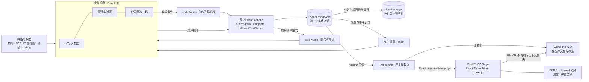

<div align="center">

# SparkMate

### 让每一块开发板，都成为会呼吸的伙伴

**一个从个人自学中长出来的多形态 AI 硬件桌宠教学网站** · Testing / 开发中

[](https://vite.dev)
[](https://react.dev)
[](https://zustand.docs.pmnd.rs)
[](https://github.com/Seange520/ai_deskpet/tree/v0.9.4a5-beta)

[](https://www.seange.cn)

### [🚀 在线体验 SparkMate](https://www.seange.cn)

无需注册、硬件或 API Key，可直接体验虚拟接线与参数预览。真实 AI 对话、编译和烧录尚未接入。

</div>

---

## 当前版本 · v0.9.4a5-beta 中央枢纽与光轨

中央枢纽新增独立机位、程序化全息沙盘、旋转刻度和岛屿名牌。闭环光轨串起枢纽与三个功能岛。Tier 2/3 使用实例化光珠和深度雾卡，桌宠随镜头飞行并在目标岛停靠。Tier 1 保留沙盘与光轨轮廓，Tier 0 提供 SVG 沙盘地图。

### v0.9.4a4-beta Space Kernel P3

空间内核通过距离剔除和 LOD 卸载远岛细节，保留焦点与目标岛。导航悬停、键盘聚焦和起飞都会预取岛屿模块。模块加载失败时保留占位几何和可操作的 DOM 教学界面。

持续低帧率时依次关闭岛屿体积光、反射、Bloom 与景深，必要时回退到 Tier 1 的 DOM 导航。固定 `?quality=3` 用于完整画质演示，`?quality=3&adaptive=1` 用于验收完整降档链路。

### v0.9.4a2-a3-beta 空间环境与 HUD 编排

四岛 Stage 加入程序化极光、暮色雾、漂浮数据模块和岛屿光束。Tier 3 使用 256 × 256 实时模糊反射和 600 个空间尘埃点，Tier 2 使用程序化光池。

Tier 2/3 正常动画下，DOM 教学面板随飞行淡出，并在抵达时从侧边分层滑入。常驻导航坞支持键盘操作，飞行中可改向。Tier 0/1 沿用页面转场，减少动态效果时直接跳切。四岛拓扑与基础航线见 [Space Kernel P0 报告](docs/SPACE_KERNEL_P0_REVIEW.md)。

### v0.9.4-beta 流光幻境 (Luminous Realm)

Hero 已接入常驻 Stage + DOM HUD 与 0–3 档画质。Tier 2 使用 Bloom、ACES Filmic、Vignette、FXAA，Tier 3 追加景深；同一场景包含极光平面、12 颗 GPU Points 和鼠标微视差，减少动画时静止。Tier 0 使用原 CSS/SVG 与 2D 常驻伙伴，Tier 1 不挂载后期链。通过 `?quality=dom`、`?quality=1`、`?quality=2`、`?quality=3` 可检查各档。

继续使用 React 18 / Fiber 8；后期依赖固定为 `@react-three/postprocessing@2.19.1` 与 `postprocessing@6.39.6`。学习状态与存档隔离，验证仍为原 65 项加 1 项 Stage 冒烟测试。实现与验收见 [P0 报告](docs/P0_STAGE_HUD_REVIEW.md)、[P1 报告](docs/P1_POSTPROCESSING_REVIEW.md)。

上一版本见 [v0.9.3-beta 发布说明](docs/RELEASE_NOTES_v0.9.3.md)。

## 项目简介

SparkMate 是我学习 AI 硬件桌宠时做的 **ESP32-S3 硬件教学 Web 应用**，也希望能帮到刚入门的同好。现在可以在浏览器里探索四条路线，认识物料、练习虚拟接线、调整示例参数；学习进度、XP、成就与音效由 Zustand 串联。

四路线的主板、屏幕、舵机、线路与教学爆炸图继续由 **CSS / SVG / React** 绘制；右下角常驻伙伴使用 **React Three Fiber / Three.js** 基础几何进行实时 3D 渲染，无外部模型、纹理或图片素材依赖。字体随构建打包，运行时无需请求外部素材 CDN；目前没有实现离线安装或缓存。

## 💡 项目缘起与开发历程

最初没想做一个完整平台。我只是想自己学习 AI 硬件桌宠，弄清楚 ESP32、屏幕、麦克风这些零件怎么配合，于是搭了一个测试网页，把查过的资料和想试的交互放进去，方便自己边看边学。

学着学着，新点子就多了起来：桌宠除了方块，还能不能是四足、小车或球形？零件堆在一起看不明白，就试着做爆炸图；接线容易记混，就加上配对练习和可重置的烧板提示。后来又顺手接了全局进度、音效和成就系统，让每次练习有一点反馈。没有一开始就定好的宏大方案，是一边自学、一边试错，慢慢迭代成现在这个样子。

项目目前仍处于 **Testing / 开发中**。网页里的预览和课程规则验证，距离真实硬件联调还有不少工作；现有测试通过，也不代表实体桌宠已经验收。把代码开源在这里，主要是记录自己的学习轨迹和实现取舍，也欢迎同好提 Issue、指出知识点或实现上的问题，一起交流。以后可以把它整理成简历或作品展示，但眼下更想先把自己没弄懂的东西弄懂，把已有功能打磨扎实。

## 核心亮点

- **🚀 打开即用** — 无需登录与实体硬件，浏览器内即可完成整条学习路径，可以先试一遍虚拟流程，再决定从哪条硬件路线开始。
- **🧊 商业级 3D 交互体验** — 常驻 3D 桌宠响应真实沙盒的移动与亮灯指令，配合异步加载、按需渲染、后台暂停和原 2D WebGL 降级，在视觉表现与可用性之间做好平衡。
- **🧭 四条路线** — 经典方块桌宠、迷你四足机器狗、履带/麦轮小车、球形自平衡机器人，同一套教学框架覆盖不同硬件形态。
- **🧠 单一状态源** — Zustand `useLearningStore` 统一管理路线选择、三关进度、XP、徽章、静音与反馈事件，跨页面实时联动。
- **🔊 成就与音效闭环** — 各路线首次完成关卡奖励 XP，全局徽章首次解锁时显示 Toast，Web Audio 合成点击/叮声/烧板嗡声，可静音并随刷新保存。
- **🎨 配置驱动** — 路线、物料、爆炸图零件坐标、引脚配对、课程代码全部收敛在数据层，扩展路线先从配置入手；新的实验类型仍可能需要补充组件。
- **♿ 无障碍与降级** — 支持键盘操作、减少动画偏好、本地存储不可用降级，窄屏自动切换移动布局。

### Phase 1：L1–L4 递进挑战

新用户仅解锁 L1 经典；代码运行符合目标后，依次开放 L2 四足、L3 履带、L4 球形。锁定路线显示灰色与锁，卡片提示前置挑战，下拉和全局选路动作同样检查解锁状态。

| 等级 | 同一次运行的通关目标                       |
| ---- | ------------------------------------------ |
| L1   | 前进并亮灯，最后前进 / LED 亮              |
| L2   | 后退、亮灯、成功音效，最后后退 / LED 亮    |
| L3   | 依次前进、停止、关灯，最后停止 / LED 灭    |
| L4   | 依次亮灯、前进、后退、停止、关灯、成功音效 |

必须在同一次运行中显式完成目标，不能拼接之前运行的状态；语法错误或最终状态不符不通关。首次通关有彩带和音效（遵守静音、减少动画），重练不重复解锁，刷新不重播庆祝。挑战和原有物料/接线/参数课程分别记录，原有 XP 口径不变。

解锁与挑战完成记录由 Zustand 持久化到原 localStorage 键。旧记录按已使用路线保留连续访问范围，不把旧关卡误标为挑战完成；重置学习进度后回到仅 L1。当前目标只控制虚拟桌宠，不代表八关节步态或自平衡实现。

### 轻量代码运行器（本地迭代）

代码魔改工坊顶部新增原生 textarea 编辑区与桌宠结果区。默认示例支持 move("forward")、light("on")、play("success")；还可尝试 backward / stop 和 off。指令按顺序执行，最后状态同步到右下角常驻伙伴。错误以红色显示在页面控制台，修正后可重新运行。

运行器不增加依赖，使用有限语法解析和白名单规范化后通过 new Function 执行教学指令，不接受任意 JavaScript、变量、循环或浏览器 API。支持分号、换行、单/双引号及注释，限制 8192 字符 / 32 条指令；整段校验通过才开始执行。运行状态仅保留在当前页面内存中，刷新复位，不额外奖励 XP；符合 Phase 1 目标时仍按原规则记录通关并解锁下一路线。音效沿用全局静音与不可用降级。

这只是预览指令运行器，不是 Arduino 编译器、通用代码沙盒或真实硬件控制。原有四路线参数实验保留在下方。开发验证可运行 node --test tests/code-runner.unit.mjs 以及 npm run test:e2e。

### Phase 2：Debug 故障排查（本地迭代）

硬件实验室可切换「正常模式 / Debug 挑战」。每条路线两题，依据正确配对表点击错误连线或错误目标引脚自动修复，支持键盘操作。正确修复显示绿色反馈并播放成功音效；选错位置显示红色模拟短路警告和警告音，不触发正常接线模式的全屏烧板结局。

每题仅首次奖励 25 XP，按路线和题目 ID 持久保存；切换模式、路线、重载或重复练习不能刷分。基础课程仍每路线 500 XP，8 题额外 200 XP，全局上限 2200 XP，经验条与排行榜使用同一累计值。旧记录迁移时 Debug 完成态默认为空，已有 XP 和解锁记录保留。重置学习进度会清空 Debug 奖励记录。

路线卡片标题只含等级与难度，例如 L2 · 进阶；下方任务进度按物料、接线、参数、代码挑战四项计算，与难度数值分离。全部四项完成才显示「已完成」，下一路线仍由代码挑战解锁。Debug 不改变这四项任务或代码闯关记录。

Debug 为离线课程诊断，不给实物通电；示例 GPIO 需要与实际开发板和固件核对，经典路线新增的 SD 数据线示例并非完整 I2S 接线。

### Phase 3：商业级 3D 交互体验

右下角常驻桌宠已由 React Three Fiber 驱动的实际 Canvas / Three.js 几何模型呈现。真实代码运行器通过原 Zustand actions 执行教学指令，`Companion` 只读订阅 `runtime` 并传给 `DeskPet3DStage`：`move` 对应前后位移与轻微浮动，`light` 对应双眼发光强度；停止、错误和复位有明确的归位反馈。3D 不重放指令、不发放奖励、不新增存档写入，也不重复触发音效。

- **主备视图**：默认 3D；加载期间、WebGL 初始化失败或上下文丢失时，回退完整保留的 `Companion2D`，继续使用同一业务状态和交互入口。
- **性能控制**：React.lazy 独立加载 3D 分包，常驻 Canvas 在导航间复用，DPR 固定为 1；静止按需渲染，弹窗、烧板遮罩或后台时暂停，减少动画偏好采用静态反馈。监听随组件卸载清理，渲染资源由 Fiber 生命周期释放。
- **主线集成**：保留收起/展开、键盘操作、学习气泡和庆祝反馈；生产构建只有主 SPA 入口，不依赖独立实验路由。
- **教学视图边界**：四个关卡的物料、接线和爆炸图仍保持现有 2D / 2.5D，不在本期改造成 3D。开发用独立 demo 继续保留，指令与存档隔离。

这里的“商业级”强调上述交互体验与降级设计，项目整体仍处于 Testing / 开发中；本机回归与短时资源观测不能替代所有设备性能、长期稳定性和实体硬件验收。实现细节与补验方法见 [3D 伙伴架构与边界](docs/deskpet3d.md)。

### 沉浸式伙伴互动（本地迭代）

右下角点击「聚焦」，可以把同一个 3D 场景放大到深色全屏视图，拖拽旋转、滚轮或双指缩放，也能重置视角。点击头部会短暂点头、浮出爱心并播放成功音效；键盘用户可使用「摸摸头」按钮。静音、减少动画、暗光休眠和后台暂停继续生效。

聚焦与摸头状态仅保留在展示组件内，不写学习存档、不奖励 XP。关闭或按 Esc 后恢复原视角与焦点；WebGL 丢失时仍回退 2D。实现和独立补验命令见 [3D 伙伴架构与边界](docs/deskpet3d.md)。

### ESP32 固件代码（本地迭代）

代码魔改工坊的硬件连接面板下方可展开「获取 ESP32 固件代码」，一键复制 Arduino 示例。示例以 115200 波特率每秒输出模拟光照和温度 JSON，无需外接传感器，便于先走通设备到网页的遥测流程。复制不可用时支持选中后手动复制；烧录由用户在 Arduino IDE 完成，网页只生成文本，不自动连接设备或改变学习进度。操作说明见 [Web Serial 连接](docs/web-serial.md)。

### 手势与移动端适配（本地迭代）

手势引擎根据 Worker 中的 WebGPU API 能力优先尝试 MediaPipe GPU delegate，初始化失败自动回退 CPU；面板显示实际引擎、运行指示灯与当前英文手势名。置信度 0.65、稳定窗口 150ms，推理最多 10 FPS，持续持有手势仍只触发一次。GPU delegate 是 SDK 提供的加速模式，不表示所有计算都通过 WebGPU 执行。

手机上按能力禁用 USB 串口并提示电脑端体验；摄像头优先前置，约束不兼容时退到通用视频请求。硬件/动作面板适配窄屏，聚焦视图支持单指旋转、双指缩放和短屏滚动；小屏或低性能设备 DPR 固定为 1，其他聚焦场景不超过 1.5，保留按需渲染、后台暂停及 2D 回退。补验说明见 [动作与手势控制](docs/phase4-interaction.md)。

### 昼夜与情绪陪伴（本地迭代）

桌宠跟随浏览器本地时间：19:00–次日 06:00 降低背景与 3D 灯光，眼睛半闭，但沙盒、手势与硬件联动照常工作。聚焦模式可切换白天/黑夜，也可恢复跟随时间。一分钟没有操作会进入闲置休眠，鼠标、触摸或键盘活动后醒来；硬件暗光和手动休眠仍优先。

在 1.8 秒内连续摸头三次，会短暂摇头并冒出小星星。昼夜与晕圈音效遵守静音，自动时钟切换只复用已运行的音频上下文。全部新状态不持久化、不写学习 Store。时间控制与验收方式见 [昼夜与情绪设计](docs/environment.md)。

## 核心功能模块

### 三关学习路径

| 关卡 | 模块         | 学习任务                           | 交互反馈                                  |  XP  |
| :--: | ------------ | ---------------------------------- | ----------------------------------------- | :--: |
|  01  | 学习仪表盘   | 认识主控、屏幕、麦克风与线材       | 3D 倾斜关卡卡片、进度条、成就墙           | +100 |
|  02  | 硬件实验室   | 供电、共地与结构层次               | 2.5D 爆炸图、拖拽接线、错误警告、模拟烧板 | +250 |
|  03  | 代码魔改工坊 | 表情、关节角度、H 桥方向、静态姿态 | 模拟 IDE、参数控制、硬件实时预览          | +150 |

> 单路线 500 XP，基础课程累计上限 2000 XP；故障挑战另有 8 × 25 XP，全局上限 2200 XP；进度保存在浏览器本地，重复练习不重复计分。

### 四路线架构

| 路线 ID     | 作品形态         | 核心硬件                     | 教学重点             | 连线练习（示例）                |
| ----------- | ---------------- | ---------------------------- | -------------------- | ------------------------------- |
| `classic`   | 经典方块桌宠     | ESP32-S3 · 屏幕 · 麦克风     | 3.3V 供电与共地      | VCC→3V3、GND→GND                |
| `quadruped` | 迷你四足机器狗   | ESP32-S3 · 8×SG90 · 独立供电 | 舵机压降与独立电源   | 舵机 VCC→EXT5V、PWM→GPIO4       |
| `tracked`   | 履带 / 麦轮小车  | ESP32-S3 · L298N · 履带底盘  | H 桥方向控制         | IN1→GPIO5、IN2→GPIO6、ENA→GPIO7 |
| `spherical` | 球形自平衡机器人 | ESP32-S3 · MPU6050 · 球壳    | I²C 传感器与姿态估计 | SDA→GPIO8、SCL→GPIO9            |

每条路线拥有独立的物料清单、爆炸图、配对规则、专属示例代码与「老创客避坑笔记」，配置集中在 `src/data/hardwareRoutes.js` 与 `src/data/routeLessons.js`。

## 技术架构



| 3D 技术栈             | 当前版本 / 职责                                               |
| --------------------- | ------------------------------------------------------------- |
| React Three Fiber     | `8.18.0`，与 React 18 配套的声明式 Canvas 与帧循环            |
| Drei / Three.js       | `9.122.0` / `0.170.0`，开发展台相机观察与基础几何、材质、灯光 |
| React.lazy / Suspense | 异步加载 3D 分包，保持主页面交互可用                          |
| 原 2D 组件            | WebGL 初始化失败、上下文丢失及加载期间的降级视图              |

### 状态流转设计

| 状态                       | 触发 Action                        | 持久化         | 消费方                      |
| -------------------------- | ---------------------------------- | -------------- | --------------------------- |
| 当前路线 `routeId`         | `selectRoute`                      | ✅             | 实验室、代码工坊、物料清单  |
| 三关完成态 `routes`        | `complete` / `reset`               | ✅             | 首页卡片、侧栏进度、XP 计算 |
| 全局 XP 与等级             | 派生计算（`totalXP` / `levelFor`） | 由完成态推导   | 进度条、排行榜、成就墙      |
| 成就徽章                   | 派生计算（`globalBadges`）         | 由完成态推导   | 成就墙、解锁 Toast          |
| 沙盒运行态 `runtime`       | `runProgram` / `resetRuntime`      | ❌（刷新复位） | 3D 常驻桌宠、代码结果区     |
| Debug 记录 `debugProgress` | `attemptFaultRepair`               | ✅             | 防刷分、全局 XP             |
| 挑战解锁与通关记录         | `runProgram` / `unlockNextLevel`   | ✅             | L1–L4 路线访问与挑战状态    |
| 静音偏好 `muted`           | `toggleMuted`                      | ✅             | 全局音效入口 `playSound`    |
| 反馈事件 `feedback`        | 关卡事件写入                       | ❌（不重播）   | 桌宠气泡、表情与音效        |

> XP 与徽章均由完成态**派生**而非独立存储，避免状态漂移；旧版 `sparkmate.progress.v1` 会自动迁移到新结构。

## 快速开始

要求 **Node.js 22.12+**（或 Node.js 24 LTS）与 npm。

```bash
# 1. 克隆仓库
git clone https://github.com/Seange520/ai_deskpet.git
cd ai_deskpet

# 2. 安装依赖
npm install

# 3. 启动开发服务器
npm run dev
```

打开终端提示的地址（默认 `http://127.0.0.1:5173/`）即可体验。

### 常用脚本

```bash
npm run build      # 生成生产构建 dist/
npm run preview    # 本地预览生产构建
npm run test:e2e   # Playwright 浏览器回归测试（默认使用本机 Chrome）
npm run qa         # 上线前质量检查（构建预检 + 规范扫描）
```

> 首次运行测试需安装 Chrome；也可通过 `PLAYWRIGHT_CHANNEL=msedge` 使用本机 Edge。

## 项目结构

```text
ai_deskpet/
├── src/
│   ├── App.jsx                     # 导航、页面编排与全局弹窗
│   ├── components/                 # 仪表盘、实验室、代码工坊、爆炸图等
│   ├── features/deskpet3d/         # 共享 3D 视图与隔离开发 demo
│   ├── data/                       # 四路线配置与课程数据（内容单一来源）
│   ├── stores/useLearningStore.js  # Zustand 全局状态与持久化
│   ├── lib/sounds.js               # Web Audio 合成音效
│   └── hooks/                      # 进度兼容适配层
├── docs/                           # 技术架构 / 功能矩阵 / 项目想法
├── tests/                          # Playwright 端到端测试
└── scripts/qa-check.mjs            # 上线前质检脚本
```

## 质量保障

- **端到端测试** — Playwright 覆盖四条路线、爆炸图拆解、拖拽接线、烧板恢复、键盘与触屏、移动布局与减少动画偏好；常驻 3D 断言读取实际模型位移和双眼材质亮度。
- **鼠标线路回归** — 常驻用例以真实鼠标坐标点击 SVG 错误曲线，验证首次 +25 XP、重练与刷新防刷分、警告/成功音效及静音；命中线路本身，不以目标引脚或键盘操作代替。
- **双向验证** — 测试中的爆炸图断言基于计算样式指纹，仅切换按钮文案或破坏 3D 层级都会使测试失败。
- **上线质检** — `npm run qa` 检查路线完整性、状态管理规范、成就/音效接线、敏感信息与仓库卫生，并执行构建预检。

## Roadmap

下面是想继续探索的方向，不是已经实现的功能，也没有固定交付日期。

- [x] 四条路线独立物料、爆炸图、配对规则与学习进度
- [x] Zustand 全局 XP、排行榜联动、成就 Toast 与事件驱动桌宠
- [x] Web Audio 合成音效、静音持久化与不可用降级
- [x] 原生文本编辑区与白名单教学指令运行器，实现「写指令 → 看 3D 桌宠反馈」闭环。
- [ ] 评估 Monaco Editor 等编辑器的体积和交互成本；更通用的代码执行环境需另行设计。
- [x] 常驻伙伴升级为 React Three Fiber / Three.js 3D 桌宠，联动真实沙盒，保留原 2D WebGL 降级；四路线教学爆炸图仍为 2D / 2.5D。
- [ ] 探索 Web Serial API，尝试让网页通过 USB 与真实开发板（如 ESP32）通信，从明确设备与协议的小实验开始。
- [ ] 扩充硬件元件库与故障排查关卡，补上常见接错、供电不足及信号理解练习。
- [ ] 确定开发板、屏幕与麦克风具体型号，提供可复现 BOM 和匹配硬件的可编译固件。
- [ ] 补充 SPI / I²C / I²S 基础课程，记录真实硬件联调过程。
- [ ] 探索真实语音链路与 AI 对话，接入前明确配置方式与隐私边界。

Monaco Editor 是代码编辑器；编辑器接入、代码执行沙盒和真实硬件通信是三项不同的工作，当前模拟 IDE 还不具备这些能力。

## 开发文档

| 文档                                       | 内容                                      |
| ------------------------------------------ | ----------------------------------------- |
| [3D 伙伴架构与边界](docs/deskpet3d.md)     | 主线联动、WebGL 降级、性能控制与隔离 demo |
| [技术架构与难点](docs/architecture.md)     | 分层设计、数据驱动、状态管理与实现取舍    |
| [功能矩阵与实现边界](docs/feature-list.md) | 已有能力、路线差异与待验证事项            |
| [项目想法与学习方向](docs/project-idea.md) | 为什么做、目前做到哪、接下来想试什么      |

## 教学边界

当前版本是**浏览器交互教学原型**：接线与代码实验均为虚拟体验，不执行真实电路仿真、C++ 编译或硬件烧录；引脚分配为教学示例，实际搭建前请断电并核对对应数据手册。舵机与电机必须使用匹配驱动和独立供电并共地，不可由主板 GPIO 或 3V3 承担动力负载。

---

<div align="center">

个人学习沉淀 · 开源硬件教学探索 · Testing / 开发中

Built while learning, shared for discussion.

</div>
