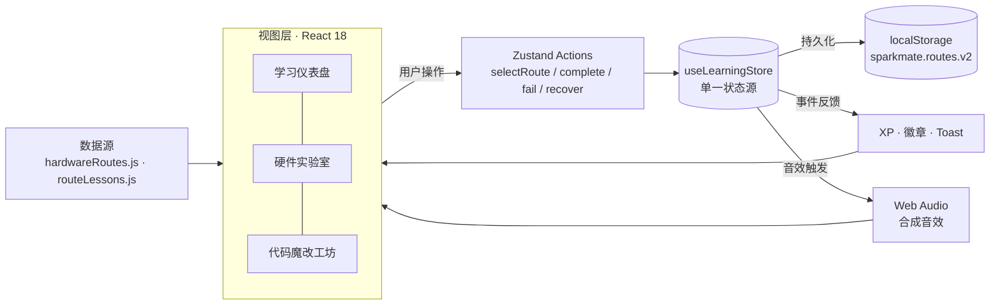

<div align="center">

# SparkMate

### 让每一块开发板，都成为会呼吸的伙伴

**面向硬件教学的多形态 AI 桌宠学习平台** · 从物料认知、虚拟接线到代码调参的完整学习闭环

[](https://vite.dev)
[](https://react.dev)
[](https://zustand.docs.pmnd.rs)
[](https://ai-deskpet-xi.vercel.app)

### [🚀 在线体验 SparkMate](https://ai-deskpet-xi.vercel.app/)

无需注册、无需硬件、无需 API Key —— 打开浏览器，三分钟完成第一个「AI 桌宠」作品。

</div>

---

## 项目简介

SparkMate 是一个面向零基础工科学生的 **ESP32-S3 硬件教学 Web 应用**：把芯片、接线与代码变成四条可探索的「多形态桌宠」创作路线，用 **Zustand 全局状态** 串联学习进度、XP、成就与音效，构建「学 → 练 → 创 → 奖」的完整正反馈闭环。

所有硬件视觉（主板、屏幕、舵机、线路、桌宠表情）均由 **CSS / SVG / React** 绘制，无图片素材依赖，断网也不影响核心学习体验。

## 核心亮点

- **🚀 打开即用** — 无需登录与实体硬件，浏览器内即可完成整条学习路径，适合课堂演示与新生导览。
- **🧭 四条路线** — 经典方块桌宠、迷你四足机器狗、履带/麦轮小车、球形自平衡机器人，同一套教学框架覆盖不同硬件形态。
- **🧠 单一状态源** — Zustand `useLearningStore` 统一管理路线选择、三关进度、XP、徽章、静音与反馈事件，跨页面实时联动。
- **🔊 成就与音效闭环** — 每关完成即时奖励 XP 与徽章 Toast，Web Audio 合成点击/叮声/烧板嗡声，可静音并随刷新保存。
- **🎨 配置驱动** — 路线、物料、爆炸图零件坐标、引脚配对、课程代码全部收敛在数据层，新增路线不改核心组件。
- **♿ 无障碍与降级** — 支持键盘操作、减少动画偏好、本地存储不可用降级，窄屏自动切换移动布局。

## 核心功能模块

### 三关学习路径

| 关卡 | 模块         | 学习任务                           | 交互反馈                                  |  XP  |
| :--: | ------------ | ---------------------------------- | ----------------------------------------- | :--: |
|  01  | 学习仪表盘   | 认识主控、屏幕、麦克风与线材       | 3D 倾斜关卡卡片、进度条、成就墙           | +100 |
|  02  | 硬件实验室   | 供电、共地与结构层次               | 2.5D 爆炸图、拖拽接线、错误警告、模拟烧板 | +250 |
|  03  | 代码魔改工坊 | 表情、关节角度、H 桥方向、静态姿态 | 模拟 IDE、参数控制、硬件实时预览          | +150 |

> 单路线 500 XP，四路线累计上限 2000 XP；进度保存在浏览器本地，重复练习不重复计分。

### 四路线架构

| 路线 ID     | 作品形态         | 核心硬件                     | 教学重点             | 连线练习（示例）                |
| ----------- | ---------------- | ---------------------------- | -------------------- | ------------------------------- |
| `classic`   | 经典方块桌宠     | ESP32-S3 · 屏幕 · 麦克风     | 3.3V 供电与共地      | VCC→3V3、GND→GND                |
| `quadruped` | 迷你四足机器狗   | ESP32-S3 · 8×SG90 · 独立供电 | 舵机压降与独立电源   | 舵机 VCC→EXT5V、PWM→GPIO4       |
| `tracked`   | 履带 / 麦轮小车  | ESP32-S3 · L298N · 履带底盘  | H 桥方向控制         | IN1→GPIO5、IN2→GPIO6、ENA→GPIO7 |
| `spherical` | 球形自平衡机器人 | ESP32-S3 · MPU6050 · 球壳    | I²C 传感器与姿态估计 | SDA→GPIO8、SCL→GPIO9            |

每条路线拥有独立的物料清单、爆炸图、配对规则、专属示例代码与「老创客避坑笔记」，配置集中在 `src/data/hardwareRoutes.js` 与 `src/data/routeLessons.js`。

## 技术架构



### 状态流转设计

| 状态                | 触发 Action                        | 持久化       | 消费方                      |
| ------------------- | ---------------------------------- | ------------ | --------------------------- |
| 当前路线 `routeId`  | `selectRoute`                      | ✅           | 实验室、代码工坊、物料清单  |
| 三关完成态 `routes` | `complete` / `fail` / `recover`    | ✅           | 首页卡片、侧栏进度、XP 计算 |
| 全局 XP 与等级      | 派生计算（`totalXP` / `levelFor`） | 由完成态推导 | 进度条、排行榜、成就墙      |
| 成就徽章            | 派生计算（`globalBadges`）         | 由完成态推导 | 成就墙、解锁 Toast          |
| 静音偏好 `muted`    | `toggleMuted`                      | ✅           | 全局音效入口 `playSound`    |
| 反馈事件 `feedback` | 关卡事件写入                       | ❌（不重播） | 桌宠气泡、表情与音效        |

> XP 与徽章均由完成态**派生**而非独立存储，避免状态漂移；旧版 `sparkmate.progress.v1` 会自动迁移到新结构。

## 快速开始

要求 **Node.js 22.12+**（或 Node.js 24 LTS）与 npm。

```bash
# 1. 克隆仓库
git clone https://github.com/Seange520/ai_deskpet.git
cd ai_deskpet

# 2. 安装依赖
npm install

# 3. 启动开发服务器
npm run dev
```

打开终端提示的地址（默认 `http://127.0.0.1:5173/`）即可体验。

### 常用脚本

```bash
npm run build      # 生成生产构建 dist/
npm run preview    # 本地预览生产构建
npm run test:e2e   # Playwright 浏览器回归测试（默认使用本机 Chrome）
npm run qa         # 上线前质量检查（构建预检 + 规范扫描）
```

> 首次运行测试需安装 Chrome；也可通过 `PLAYWRIGHT_CHANNEL=msedge` 使用本机 Edge。

## 项目结构

```text
ai_deskpet/
├── src/
│   ├── App.jsx                     # 导航、页面编排与全局弹窗
│   ├── components/                 # 仪表盘、实验室、代码工坊、爆炸图等
│   ├── data/                       # 四路线配置与课程数据（内容单一来源）
│   ├── stores/useLearningStore.js  # Zustand 全局状态与持久化
│   ├── lib/sounds.js               # Web Audio 合成音效
│   └── hooks/                      # 进度兼容适配层
├── docs/                           # 技术架构 / 功能矩阵 / 竞赛摘要
├── tests/                          # Playwright 端到端测试
└── scripts/qa-check.mjs            # 上线前质检脚本
```

## 质量保障

- **端到端测试** — Playwright 覆盖四条路线、爆炸图拆解、拖拽接线、烧板恢复、键盘与触屏、移动布局与减少动画偏好。
- **双向验证** — 测试中的爆炸图断言基于计算样式指纹，仅切换按钮文案或破坏 3D 层级都会使测试失败。
- **上线质检** — `npm run qa` 检查路线完整性、状态管理规范、成就/音效接线、敏感信息与仓库卫生，并执行构建预检。

## Roadmap

- [x] 四条路线独立物料、爆炸图、配对规则与学习进度
- [x] Zustand 全局 XP、排行榜联动、成就 Toast 与事件驱动桌宠
- [x] Web Audio 合成音效、静音持久化与不可用降级
- [ ] 确定开发板、屏幕与麦克风具体型号，提供可复现 BOM
- [ ] 补充 SPI / I²C / I²S 信号与芯片基础课程
- [ ] 提供与指定硬件匹配、可编译的 ESP32-S3 固件
- [ ] 接入真实语音链路与 AI 对话（含隐私说明）
- [ ] 使用 Electron / Tauri 打包桌面端

## 竞赛与项目文档

| 文档                                          | 内容                                       |
| --------------------------------------------- | ------------------------------------------ |
| [技术架构与难点](docs/architecture.md)        | 分层设计、数据驱动、状态管理与关键难点解法 |
| [功能矩阵与亮点](docs/feature-list.md)        | 模块完成度、四路线对比与差异化优势         |
| [竞赛一页纸摘要](docs/competition-summary.md) | 痛点、方案、创新点、成果与规划             |

## 教学边界

当前版本是**浏览器交互教学原型**：接线与代码实验均为虚拟体验，不执行真实电路仿真、C++ 编译或硬件烧录；引脚分配为教学示例，实际搭建前请断电并核对对应数据手册。舵机与电机必须使用匹配驱动和独立供电并共地，不可由主板 GPIO 或 3V3 承担动力负载。

---

<div align="center">

**本项目为广东工业大学大创项目**（大学生创新创业训练计划）

Made with ⚡ by the SparkMate Team

</div>
