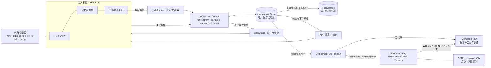
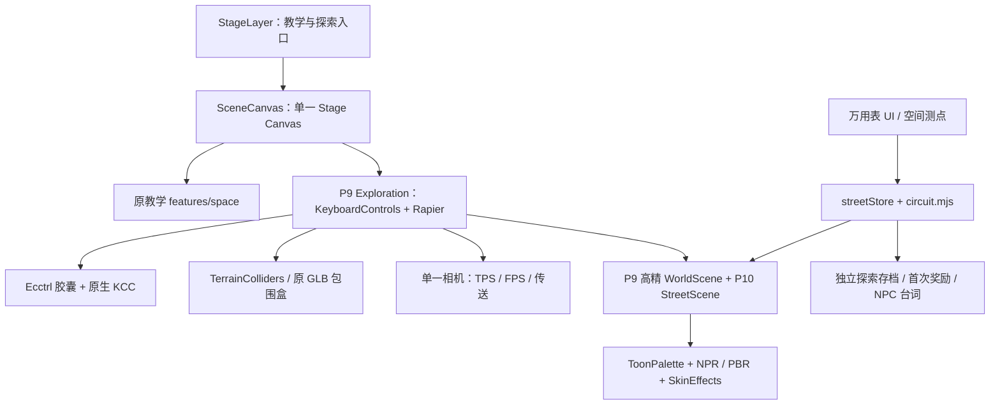

<div align="center">

# SparkMate · 第七校验

### The Seventh Checksum · 让每一块开发板，都成为会呼吸的伙伴

[](https://vite.dev)
[](https://react.dev)
[](https://zustand.docs.pmnd.rs)
[](https://github.com/Seange520/ai_deskpet/tree/v0.9.8-alpha)

[](https://www.seange.cn)

**当前版本：`v0.9.8-alpha` ·《熔炉纪元》（The Forge）· Testing / 开发中**

### [🚀 在线体验 SparkMate](https://www.seange.cn)

无需注册、硬件或 API Key，可体验虚拟接线、参数预览与桌宠互动。真实 AI 对话、网页编译烧录与实体硬件闭环尚未完成。

</div>

---

## 项目简介

SparkMate 是面向 ESP32-S3 桌宠学习的交互教学 Web 应用，也是《第七校验》的工程载体。玩家以**维护者 0** 的身份进入**流明域**，从认识元件、完成接线与编写指令，走向以测量证据修复世界。系统把学习行为、桌宠反馈和场景变化接在同一条可追溯的链路上：界面呈现问题，工具提供证据，状态层记录成果，渲染层表达结果。

架构以业务状态隔离为边界：React 编排教学和探索，Zustand 管理原教学进度，Rapier 原生 KCC 承担 P9 角色运动，独立探索 Store 保存路灯成果。**NPR + PBR 混合渲染**将 Toon 色阶、Rim、描边与陶瓷、金属、岩面、折射水晶组织成统一视觉；高精视觉资产与碰撞真源分离，保持操作与物理结果可预测。

四条硬件路线的主板、屏幕、舵机、线路与教学爆炸图继续由 **CSS / SVG / React** 绘制。原常驻桌宠使用程序化 Three.js 几何；P9 大世界另有本地原创 Blender GLB 与贴图，不能再将整个项目概括为“无模型、无纹理依赖”。字体随构建打包；尚未实现离线安装或完整缓存。

### 💡 项目缘起与开发历程

最初没想做一个完整平台。我只是想自己学习 AI 硬件桌宠，弄清楚 ESP32、屏幕、麦克风这些零件怎么配合，于是搭了一个测试网页，把查过的资料和想试的交互放进去，方便自己边看边学。

学着学着，新点子就多了起来：桌宠除了方块，还能不能是四足、小车或球形？零件堆在一起看不明白，就试着做爆炸图；接线容易记混，就加上配对练习和可重置的烧板提示。后来又顺手接了全局进度、音效和成就系统，让每次练习有一点反馈。没有一开始就定好的宏大方案，是一边自学、一边试错，慢慢迭代成现在这个样子。

项目目前仍处于 **Testing / 开发中**。网页里的预览和课程规则验证，距离真实硬件联调还有不少工作；现有测试通过，也不代表实体桌宠已经验收。把代码开源在这里，主要是记录自己的学习轨迹和实现取舍，也欢迎同好提 Issue、指出知识点或实现上的问题，一起交流。以后可以把它整理成简历或作品展示，但眼下更想先把自己没弄懂的东西弄懂，把已有功能打磨扎实。

## 核心特性

### R1 三渲二对比原型（待视觉与性能验收）

本地打开 `/?quality=3&render=toon&boot=0`，可查看程序化晴光街、两个桌宠和地标塔；控制面板支持 Toon/PBR 对比、昼夜时间、描边和可选景深。原型默认关闭，仅在 Tier 3 与显式 `render=toon` / `render=standard` 参数同时满足时加载。使用现有 Three.js/R3F 与后处理依赖，无新增素材或依赖。

运行 `npm run check:render-r1` 可生成四张 1080p 验收图和逐场景性能表；服务器地址通过 `SPARKMATE_RENDER_URL` 指定。当前环境的构建与浏览器子进程被权限限制阻断，**尚无截图、FPS 或 67 项 E2E 通过结论**，详见 [R1 验收记录](work/acceptance/render-r1/ACCEPTANCE.md)。

### 🚀 基础教学与跨页反馈

- **🚀 打开即用** — 无需登录与实体硬件，浏览器内即可完成整条学习路径，可以先试一遍虚拟流程，再决定从哪条硬件路线开始。
- **🧊 商业级 3D 交互体验** — 常驻 3D 桌宠响应真实沙盒的移动与亮灯指令，配合异步加载、按需渲染、后台暂停和原 2D WebGL 降级，在视觉表现与可用性之间做好平衡。
- **🧭 四条路线** — 经典方块桌宠、迷你四足机器狗、履带/麦轮小车、球形自平衡机器人，同一套教学框架覆盖不同硬件形态。
- **🧠 单一状态源** — Zustand `useLearningStore` 统一管理路线选择、三关进度、XP、徽章、静音与反馈事件，跨页面实时联动。
- **🔊 成就与音效闭环** — 各路线首次完成关卡奖励 XP，全局徽章首次解锁时显示 Toast，Web Audio 合成点击/叮声/烧板嗡声，可静音并随刷新保存。
- **🎨 配置驱动** — 路线、物料、爆炸图零件坐标、引脚配对、课程代码全部收敛在数据层，扩展路线先从配置入手；新的实验类型仍可能需要补充组件。
- **♿ 无障碍与降级** — 支持键盘操作、减少动画偏好、本地存储不可用降级，窄屏自动切换移动布局。

### 三关学习路径

| 关卡 | 模块         | 学习任务                           | 交互反馈                                  |  XP  |
| :--: | ------------ | ---------------------------------- | ----------------------------------------- | :--: |
|  01  | 学习仪表盘   | 认识主控、屏幕、麦克风与线材       | 3D 倾斜关卡卡片、进度条、成就墙           | +100 |
|  02  | 硬件实验室   | 供电、共地与结构层次               | 2.5D 爆炸图、拖拽接线、错误警告、模拟烧板 | +250 |
|  03  | 代码魔改工坊 | 表情、关节角度、H 桥方向、静态姿态 | 模拟 IDE、参数控制、硬件实时预览          | +150 |

> 单路线 500 XP，基础课程累计上限 2000 XP；故障挑战另有 8 × 25 XP，全局上限 2200 XP；进度保存在浏览器本地，重复练习不重复计分。

### 四路线架构

| 路线 ID     | 作品形态         | 核心硬件                     | 教学重点             | 连线练习（示例）                |
| ----------- | ---------------- | ---------------------------- | -------------------- | ------------------------------- |
| `classic`   | 经典方块桌宠     | ESP32-S3 · 屏幕 · 麦克风     | 3.3V 供电与共地      | VCC→3V3、GND→GND                |
| `quadruped` | 迷你四足机器狗   | ESP32-S3 · 8×SG90 · 独立供电 | 舵机压降与独立电源   | 舵机 VCC→EXT5V、PWM→GPIO4       |
| `tracked`   | 履带 / 麦轮小车  | ESP32-S3 · L298N · 履带底盘  | H 桥方向控制         | IN1→GPIO5、IN2→GPIO6、ENA→GPIO7 |
| `spherical` | 球形自平衡机器人 | ESP32-S3 · MPU6050 · 球壳    | I²C 传感器与姿态估计 | SDA→GPIO8、SCL→GPIO9            |

每条路线拥有独立的物料清单、爆炸图、配对规则、专属示例代码与「老创客避坑笔记」，配置集中在 `src/data/hardwareRoutes.js` 与 `src/data/routeLessons.js`。

### Phase 1：L1–L4 递进挑战

新用户仅解锁 L1 经典；代码运行符合目标后，依次开放 L2 四足、L3 履带、L4 球形。锁定路线显示灰色与锁，卡片提示前置挑战，下拉和全局选路动作同样检查解锁状态。

| 等级 | 同一次运行的通关目标                       |
| ---- | ------------------------------------------ |
| L1   | 前进并亮灯，最后前进 / LED 亮              |
| L2   | 后退、亮灯、成功音效，最后后退 / LED 亮    |
| L3   | 依次前进、停止、关灯，最后停止 / LED 灭    |
| L4   | 依次亮灯、前进、后退、停止、关灯、成功音效 |

必须在同一次运行中显式完成目标，不能拼接之前运行的状态；语法错误或最终状态不符不通关。首次通关有彩带和音效（遵守静音、减少动画），重练不重复解锁，刷新不重播庆祝。挑战和原有物料/接线/参数课程分别记录，原有 XP 口径不变。

解锁与挑战完成记录由 Zustand 持久化到原 localStorage 键。旧记录按已使用路线保留连续访问范围，不把旧关卡误标为挑战完成；重置学习进度后回到仅 L1。当前目标只控制虚拟桌宠，不代表八关节步态或自平衡实现。

### 轻量代码运行器（已实现）

代码魔改工坊顶部新增原生 textarea 编辑区与桌宠结果区。默认示例支持 move("forward")、light("on")、play("success")；还可尝试 backward / stop 和 off。指令按顺序执行，最后状态同步到右下角常驻伙伴。错误以红色显示在页面控制台，修正后可重新运行。

运行器不增加依赖，使用有限语法解析和白名单规范化后通过 new Function 执行教学指令，不接受任意 JavaScript、变量、循环或浏览器 API。支持分号、换行、单/双引号及注释，限制 8192 字符 / 32 条指令；整段校验通过才开始执行。运行状态仅保留在当前页面内存中，刷新复位，不额外奖励 XP；符合 Phase 1 目标时仍按原规则记录通关并解锁下一路线。音效沿用全局静音与不可用降级。

这只是预览指令运行器，不是 Arduino 编译器、通用代码沙盒或真实硬件控制。原有四路线参数实验保留在下方。开发验证可运行 node --test tests/code-runner.unit.mjs 以及 npm run test:e2e。

### Phase 2：Debug 故障排查（已实现）

硬件实验室可切换「正常模式 / Debug 挑战」。每条路线两题，依据正确配对表点击错误连线或错误目标引脚自动修复，支持键盘操作。正确修复显示绿色反馈并播放成功音效；选错位置显示红色模拟短路警告和警告音，不触发正常接线模式的全屏烧板结局。

每题仅首次奖励 25 XP，按路线和题目 ID 持久保存；切换模式、路线、重载或重复练习不能刷分。基础课程仍每路线 500 XP，8 题额外 200 XP，全局上限 2200 XP，经验条与排行榜使用同一累计值。旧记录迁移时 Debug 完成态默认为空，已有 XP 和解锁记录保留。重置学习进度会清空 Debug 奖励记录。

路线卡片标题只含等级与难度，例如 L2 · 进阶；下方任务进度按物料、接线、参数、代码挑战四项计算，与难度数值分离。全部四项完成才显示「已完成」，下一路线仍由代码挑战解锁。Debug 不改变这四项任务或代码闯关记录。

Debug 为离线课程诊断，不给实物通电；示例 GPIO 需要与实际开发板和固件核对，经典路线新增的 SD 数据线示例并非完整 I2S 接线。

### Phase 3：商业级 3D 交互体验

右下角常驻桌宠已由 React Three Fiber 驱动的实际 Canvas / Three.js 几何模型呈现。真实代码运行器通过原 Zustand actions 执行教学指令，`Companion` 只读订阅 `runtime` 并传给 `DeskPet3DStage`：`move` 对应前后位移与轻微浮动，`light` 对应双眼发光强度；停止、错误和复位有明确的归位反馈。3D 不重放指令、不发放奖励、不新增存档写入，也不重复触发音效。

- **主备视图**：默认 3D；加载期间、WebGL 初始化失败或上下文丢失时，回退完整保留的 `Companion2D`，继续使用同一业务状态和交互入口。
- **性能控制**：React.lazy 独立加载 3D 分包，常驻 Canvas 在导航间复用，DPR 固定为 1；静止按需渲染，弹窗、烧板遮罩或后台时暂停，减少动画偏好采用静态反馈。监听随组件卸载清理，渲染资源由 Fiber 生命周期释放。
- **主线集成**：保留收起/展开、键盘操作、学习气泡和庆祝反馈；生产构建只有主 SPA 入口，不依赖独立实验路由。
- **教学视图边界**：四个关卡的物料、接线和爆炸图仍保持现有 2D / 2.5D，不在本期改造成 3D。开发用独立 demo 继续保留，指令与存档隔离。

这里的“商业级”强调上述交互体验与降级设计，项目整体仍处于 Testing / 开发中；本机回归与短时资源观测不能替代所有设备性能、长期稳定性和实体硬件验收。实现细节与补验方法见 [3D 伙伴架构与边界](docs/deskpet3d.md)。

### 沉浸式伙伴互动（已实现）

右下角点击「聚焦」，可以把同一个 3D 场景放大到深色全屏视图，拖拽旋转、滚轮或双指缩放，也能重置视角。点击头部会短暂点头、浮出爱心并播放成功音效；键盘用户可使用「摸摸头」按钮。静音、减少动画、暗光休眠和后台暂停继续生效。

聚焦与摸头状态仅保留在展示组件内，不写学习存档、不奖励 XP。关闭或按 Esc 后恢复原视角与焦点；WebGL 丢失时仍回退 2D。实现和独立补验命令见 [3D 伙伴架构与边界](docs/deskpet3d.md)。

### ESP32 固件代码（已实现）

代码魔改工坊的硬件连接面板下方可展开「获取 ESP32 固件代码」，一键复制 Arduino 示例。示例以 115200 波特率每秒输出模拟光照和温度 JSON，无需外接传感器，便于先走通设备到网页的遥测流程。复制不可用时支持选中后手动复制；烧录由用户在 Arduino IDE 完成，网页只生成文本，不自动连接设备或改变学习进度。操作说明见 [Web Serial 连接](docs/web-serial.md)。

### 手势与移动端适配（已实现）

手势引擎根据 Worker 中的 WebGPU API 能力优先尝试 MediaPipe GPU delegate，初始化失败自动回退 CPU；面板显示实际引擎、运行指示灯与当前英文手势名。置信度 0.65、稳定窗口 150ms，推理最多 10 FPS，持续持有手势仍只触发一次。GPU delegate 是 SDK 提供的加速模式，不表示所有计算都通过 WebGPU 执行。

手机上按能力禁用 USB 串口并提示电脑端体验；摄像头优先前置，约束不兼容时退到通用视频请求。硬件/动作面板适配窄屏，聚焦视图支持单指旋转、双指缩放和短屏滚动；小屏或低性能设备 DPR 固定为 1，其他聚焦场景不超过 1.5，保留按需渲染、后台暂停及 2D 回退。补验说明见 [动作与手势控制](docs/phase4-interaction.md)。

### 昼夜与情绪陪伴（已实现）

桌宠跟随浏览器本地时间：19:00–次日 06:00 降低背景与 3D 灯光，眼睛半闭，但沙盒、手势与硬件联动照常工作。聚焦模式可切换白天/黑夜，也可恢复跟随时间。一分钟没有操作会进入闲置休眠，鼠标、触摸或键盘活动后醒来；硬件暗光和手动休眠仍优先。

在 1.8 秒内连续摸头三次，会短暂摇头并冒出小星星。昼夜与晕圈音效遵守静音，自动时钟切换只复用已运行的音频上下文。全部新状态不持久化、不写学习 Store。时间控制与验收方式见 [昼夜与情绪设计](docs/environment.md)。

### 🌌 P9 开放世界与 P10 工程解谜

- **🧭 原生 KCC 漫游**：保留 Ecctrl 胶囊外壳、固定 1/60s 步长、重力 -9.81、45° 爬坡、0.5m 台阶与跳跃；TerrainColliders 和原模型包围盒承担碰撞。
- **🎥 单一相机与地图传送**：TPS 弹簧臂、TPS/FPS 连续插值、FOV 65→72、材质小地图、三段传送与 960 粒子重组共享原有控制链。
- **🎨 NPR + PBR 场景**：唯一 P9 SkinEffects composer 输出 GTAO、Bloom、ACES 与 FXAA；原创高精资产保留冷暖补光、软阴影、贴地接触阴影和细弧光轨。
- **🔎 万用表鹰眼**：电压/通断两档、穿墙暗线与节点、空间测点、专注消耗和证据门控共同构成排障工具；带电测通断由安全联锁拦截。
- **🔥 确定性热故障链**：24V 仿真以 I²R 发热、散热与 I²t 熔断驱动发红、白烟、火花、明火和断电；熔断后需更换保险丝才能继续。
- **🧠 世界反馈与隔离奖励**：修复后完整观察 7 秒稳定周期，触发夜宵摊 NPC 台词；首次获得 120 知识 XP 与 1 枚记忆棱镜，独立保存且防重复领取。
- **♿ 质量与输入守卫**：Tier 0 零 Stage Canvas，Tier 1/2 保留原教学导航；P9 探索仅 Tier 3 启用。地图、模态、失焦冻结输入，移动端保留摇杆与右屏拖动。

### P10-P0《会呼吸的路灯》操作闭环

熔炉外街位于中央枢纽通往硬件台地的原连桥，两端保持通行。每 7 秒的压缩机启动伴随路灯电压跌落；正确排障需要区分回流接点虚接与启动浪涌。

1. 开启鹰眼，切电压档，点击 L1 路灯、G0 回流接点、M1 压缩机，比较压降与启动现象。每次测量消耗 12 专注，关闭鹰眼恢复专注。
2. 断电隔离后用通断档测 G0，依据记录确认“接地不良”和“启动过载”。这里的 G0 是 **0V 工作回流接点**，保护接地 PE 不承担工作回流。
3. 若强行跨接供电，观察热故障链和保险丝切断；断电检查、更换保险丝并拆除错误跨接后才能继续。
4. 修复接点、分设工作回流线，为压缩机加入软启动，再恢复供电并完成 7 秒验收。
5. 夜宵摊老板说：“今晚灯没眨，客人多了一倍。”独立探索奖励首次发放，刷新保留。

热参数与时间压缩用于教学演示，不代表真实器件的认证保护曲线。完整实现与验证见 [P10 切片验收](docs/P10_STREET_P0_REVIEW.md)。

### P10-M1《反峰陷阱》本地开发切片（未发布）

在同一探索入口沿东侧连桥继续前行，进入冷库控制柜支路。首次进入需完成 30 秒观察微课与单选，再记录 2–3 条假设；六种透镜及多量程测量帮助区分分断尖峰、控制复位与工作回流。离线诊断后，可按正确极性安装续流二极管或 RC 吸收；连续 10 次安全分断才触发 NPC 反馈，首次独立获得 100 XP 与 1 枚记忆棱镜。

M1 使用独立版本化存档 `sparkmate.seventh-checksum.kickback.v1`，不接入原 2200 XP、排行榜或 P0 奖励。L/R、峰值、耦合与能量累积属于确定性的等效教学模型；交流档显示约定分断包络的 RMS 保持值，不能据此宣称真实仪表带宽或器件保护认证。范围、参数、复现与本轮证据见 [M1 审核记录](docs/P10_M1_KICKBACK_REVIEW.md)。发布版本和既有标签仍为 `v0.9.8-alpha`，本轮不提交、不推送、不打标签。

## 技术架构

### 原教学与常驻桌宠



| 3D 技术栈             | 当前版本 / 职责                                               |
| --------------------- | ------------------------------------------------------------- |
| React Three Fiber     | `8.18.0`，与 React 18 配套的声明式 Canvas 与帧循环            |
| Drei / Three.js       | `9.122.0` / `0.170.0`，开发展台相机观察与基础几何、材质、灯光 |
| React.lazy / Suspense | 异步加载 3D 分包，保持主页面交互可用                          |
| 原 2D 组件            | WebGL 初始化失败、上下文丢失及加载期间的降级视图              |

#### 状态流转设计

| 状态                       | 触发 Action                        | 持久化         | 消费方                      |
| -------------------------- | ---------------------------------- | -------------- | --------------------------- |
| 当前路线 `routeId`         | `selectRoute`                      | ✅             | 实验室、代码工坊、物料清单  |
| 三关完成态 `routes`        | `complete` / `reset`               | ✅             | 首页卡片、侧栏进度、XP 计算 |
| 全局 XP 与等级             | 派生计算（`totalXP` / `levelFor`） | 由完成态推导   | 进度条、排行榜、成就墙      |
| 成就徽章                   | 派生计算（`globalBadges`）         | 由完成态推导   | 成就墙、解锁 Toast          |
| 沙盒运行态 `runtime`       | `runProgram` / `resetRuntime`      | ❌（刷新复位） | 3D 常驻桌宠、代码结果区     |
| Debug 记录 `debugProgress` | `attemptFaultRepair`               | ✅             | 防刷分、全局 XP             |
| 挑战解锁与通关记录         | `runProgram` / `unlockNextLevel`   | ✅             | L1–L4 路线访问与挑战状态    |
| 静音偏好 `muted`           | `toggleMuted`                      | ✅             | 全局音效入口 `playSound`    |
| 反馈事件 `feedback`        | 关卡事件写入                       | ❌（不重播）   | 桌宠气泡、表情与音效        |

> XP 与徽章均由完成态**派生**而非独立存储，避免状态漂移；旧版 `sparkmate.progress.v1` 会自动迁移到新结构。

### Stage、物理与探索状态链



原教学 `features/space/WorldScene.jsx` 与 P9 `features/world/WorldScene.jsx` 职责不同。P9 视觉高模、生态、光束和老街不自动生成新碰撞覆盖原地形；Ecctrl 默认移动和跟随相机关闭，由原生 KCC 与唯一相机回调控制。触屏摇杆可有自己的辅助 Canvas，不增加第二个 Stage renderer 或竞争 composer。

| 状态边界       | 数据与持久化                                                                                 |
| -------------- | -------------------------------------------------------------------------------------------- |
| 原教学         | `useLearningStore`；`sparkmate.routes.v2` 保存路线、完成记录与偏好，XP 从完成态派生          |
| 硬件与动作     | 遥测、连接、动作和环境主要是会话态；不伪造教学完成记录                                       |
| 地图与探索输入 | `navigationStore` / `explorationState`；位置、传送与输入会话态                               |
| P10 路灯       | `streetStore` / `circuit.mjs`；`sparkmate.seventh-checksum.street.v1` 独立保存验收与首次奖励 |

P10 的 120 XP 不并入原教学 2200 XP 上限或原排行榜，避免探索改变既有课程语义。

| 补充依赖                                     | 固定版本 / 职责                |
| -------------------------------------------- | ------------------------------ |
| React                                        | 18.3.1                         |
| @react-three/rapier / ecctrl                 | 1.5.0 / 1.0.90，物理与角色外壳 |
| @react-three/postprocessing / postprocessing | 2.19.1 / 6.39.6，后处理        |

### 项目结构

```text
ai_deskpet/
├── src/
│   ├── App.jsx                     # 导航、页面编排与全局弹窗
│   ├── components/                 # 仪表盘、实验室、代码工坊、爆炸图
│   ├── features/stage/             # Stage Canvas 与生命周期
│   ├── features/world/             # P9 物理、地图、相机、传送与高精视觉
│   ├── features/street/            # 路灯电路、街区、测点与独立奖励
│   ├── features/space/             # 原教学世界
│   ├── features/deskpet3d/         # 共享 3D 视图与隔离开发 demo
│   ├── features/hardware/          # 串口、浏览器演示与开发者面板
│   ├── data/                      # 四路线配置、课程与 Lore 数据
│   ├── stores/useLearningStore.js  # 原教学状态与持久化
│   ├── lib/sounds.js              # Web Audio 合成音效
│   └── hooks/                     # 进度兼容适配层
├── public/assets/                 # 本地模型与纹理
├── docs/                          # 架构、功能矩阵、历史与验收
├── tests/                         # Playwright E2E 与单测
└── scripts/                       # 构建、质检、专项验收与 Blender 生成源
```

## 开发调试指南

### 安装与原教学入口

原 README 的环境要求为 Node.js 22.12+；本地构建与本文测试命令使用 Node.js 24 + npm 验证。

```bash
git clone https://github.com/Seange520/ai_deskpet.git
cd ai_deskpet
npm ci
npm run dev
```

打开终端提示地址，默认 `http://127.0.0.1:5173/`。已有的 `npm install` 安装方式保留；使用仓库锁文件复现依赖时采用 `npm ci`。

### P9 大世界与熔炉外街

```bash
npm run dev -- --port 15262 --strictPort
```

打开 `http://127.0.0.1:15262/?quality=3&world=p9`，点击“开始自由探索”，沿中央枢纽通往硬件台地的东侧连桥进入熔炉外街。

| 操作               | 输入                                         |
| ------------------ | -------------------------------------------- |
| 移动 / 跑动 / 跳跃 | WASD 或方向键 / Shift / 空格                 |
| 观察 / 切换视角    | 鼠标拖动 / V 平滑切换 TPS 与 FPS             |
| 地图 / 返回        | M 打开地图；Esc 先关闭地图，再回原教学       |
| 移动端             | 左侧 EcctrlJoystick + 右屏拖视角；仪表可收起 |

`?quality=dom`、`?quality=1`、`?quality=2`、`?quality=3` 用于分档检查；`?quality=3&adaptive=1` 用于检查自适应降档。Tier 1/2 的原教学导航降级不等于完整 P9 漫游。

### 硬件演示与调试入口

代码魔改工坊保留三种互斥接收来源：真实 Web Serial、无需 USB/Node 的浏览器光感演示、本机 Node 虚拟桥接。默认不连接设备、不请求摄像头。

- **浏览器演示**：点击后接收模拟 JSON，遮光/恢复光照驱动桌宠休眠；SVG 保留最近 60 个样本，分类日志最多 40 行。支持暂停保值、模拟拔线、非法数据拦截与恢复，断开和离页清理会话。
- **开发者入口**：在硬件面板内聚焦控件后按 `Ctrl+Shift+D`，或在 1.5 秒相邻间隔内连续点击“连接真实 ESP32”标题五次，展开 `DevToolsPanel`。它是防误操作入口，不是身份认证；刷新或离开后恢复隐藏。
- **Node 虚拟光感**：手动执行 `node scripts/virtual-esp32.mjs`，再通过调试面板连接。它是本机 HTTP NDJSON 流，不是 USB COM 设备；默认监听 `127.0.0.1:8765`，支持 `--dark`、`--light`、`--port`、`--samples` 和 `--no-bridge`。
- **真实串口接收**：用户选择串口后才打开，默认 115200 baud，可选 9600；解析逐行 UTF-8 JSON，例如 `{"temp":25,"light":300}`。支持分包和 CRLF；拒绝非法值和超长行，`light` 是未标定原始读数。只读接收不代表设备身份确认、控制 ACK、编译或烧录验收。

固件文本复制、手势引擎、聚焦摸头与昼夜休眠的完整操作保留在上文功能说明，另见 [Web Serial](docs/web-serial.md)、[动作与手势](docs/phase4-interaction.md)、[昼夜与情绪](docs/environment.md)。

### 构建与常用命令

```bash
npm run build       # 标准生产构建，输出 dist/
npm run build:local # Windows 兼容入口，使用项目内构建临时目录
npm run preview     # 预览生产构建
npm run test:e2e    # Playwright 原有浏览器回归
npm run test:special # 既有空间与画质专项组合
npm run qa          # 构建预检、规范扫描与仓库卫生检查
```

本机 Windows 系统 TEMP 曾导致 esbuild 清理失败，使用既有 `build:local` 兼容入口；不因此修改业务逻辑或忽略构建错误。

## 测试验证

### 原有质量保障

- **端到端测试** — Playwright 覆盖四条路线、爆炸图拆解、拖拽接线、烧板恢复、键盘与触屏、移动布局与减少动画偏好；常驻 3D 断言读取实际模型位移和双眼材质亮度。
- **鼠标线路回归** — 常驻用例以真实鼠标坐标点击 SVG 错误曲线，验证首次 +25 XP、重练与刷新防刷分、警告/成功音效及静音；命中线路本身，不以目标引脚或键盘操作代替。
- **双向验证** — 测试中的爆炸图断言基于计算样式指纹，仅切换按钮文案或破坏 3D 层级都会使测试失败。
- **上线质检** — `npm run qa` 检查路线完整性、状态管理规范、成就/音效接线、敏感信息与仓库卫生，并执行构建预检。

### 测试命令与证据口径

E2E 使用本机 Chrome，也可通过 `PLAYWRIGHT_CHANNEL=msedge` 选择本机 Edge。独立场景脚本可能固定使用 Chrome，应以各脚本为准。E2E 自行启动专属服务，不复用未知端口上的项目。

```powershell
$env:SPARKMATE_TEST_PORT='15261'
npm run test:e2e
```

原运行器单测与 P10 相关质量/传送/电路单测：

```bash
node --test tests/code-runner.unit.mjs
node --test --test-isolation=none tests/m2-quality.unit.mjs tests/quality-tier.unit.mjs tests/travel-timeline.unit.mjs tests/teleport-timeline.unit.mjs tests/street-circuit.unit.mjs
```

M1 新增模型与反应表单测（可与上面的原 14 项一起执行）：

```bash
node --test --test-isolation=none tests/kickback-circuit.unit.mjs tests/reactions.unit.mjs
```

保持 15262 的正常开发服务运行后，按顺序执行：

```bash
node scripts/check-street-p0.mjs
node scripts/check-street-m1.mjs # 本地 M1 真实键鼠闭环与证据
node scripts/check-world-m1.mjs
node scripts/check-world-m3.mjs
node scripts/check-world-rail.mjs
```

原桌宠、串口、手势与环境的补验入口继续保留：

```bash
node scripts/check-main-deskpet3d.mjs
node scripts/check-pet-focus.mjs
node scripts/check-web-serial.mjs
node scripts/check-firmware-generator.mjs
node scripts/check-phase4-interaction.mjs
node scripts/check-adaptive-mobile.mjs
node scripts/check-environment.mjs
```

这些历史脚本的默认端口不统一；运行前按对应文档设置 `SPARKMATE_MAIN_URL`、`SPARKMATE_FOCUS_URL`、`SPARKMATE_SERIAL_URL`、`SPARKMATE_FIRMWARE_URL`、`SPARKMATE_INTERACTION_URL`、`SPARKMATE_ADAPTIVE_URL`、`SPARKMATE_ENVIRONMENT_URL`。测试期间冻结源码，避免 Vite 热更新让 Canvas 句柄失效。临时产物写入忽略的 `test-results/`；长期证据应另行归档。

| 历史验收节点            | 已归档结果                                           |
| ----------------------- | ---------------------------------------------------- |
| v0.9.0～v0.9.3 核心回归 | 65 项 E2E；早期不同切片按当时记录核对                |
| Stage 与空间内核演进    | 66 项，移除侧栏与空间热点闭环后扩展为 67 项          |
| P9 封板                 | E2E 67/67、质量/传送单测 8/8、视觉专项 3/3、构建通过 |
| P10-P0 路灯切片         | E2E 67/67、相关单测 14/14、P10 专项 4/4、构建通过    |
| P10 后的 P9 复验        | 物理 M1 8/8（复测）、地图 M3 6/6、光轨 3/3           |

这些是相应代码封板时的历史实测，不将历史通过冒充本次 README 重写的新测。M1 首轮曾在“关闭模态 300ms 后恢复步进”的断言失败，同源码与原断言重跑通过，根因尚未确认，保留记录见 [P10 验收说明](docs/P10_STREET_P0_REVIEW.md)。不删除、跳过或弱化既有断言掩盖回归。

## 全生命周期版本编年史（Roadmap）

本节依据本仓库 Git Log、标签解引用、原版 README 和发布说明整理。**章节名是整理后的发展阶段，真实发布名称以“历史标签 / 提交”栏为准。** `v0.9.4-pre`、`v0.9.5-pre` 未在仓库发布过，不补打、不重命名旧标签。部分阶段跨真实版本边界，以保留叙事分期和代码事实。

### The Origin (v0.9.0) · 第一行代码与教学底座

**真实起点**：`5255c85`；**历史封板标签**：`v0.9.0-beta` → `339ce41`，历史代号“基石重构”（The Bedrock）。

- 最初的 `5255c85` 只有 README、AGENTS 与忽略规则，定义学习仪表盘、虚拟硬件展馆和代码工坊三模块；不能把后续 Store 或 3D 能力写成首个提交已经实现。
- `284c623` 落地 React/Vite 工程、仪表盘、硬件模拟器、代码工坊、CSS/SVG 视觉和首批测试；`3329d05` 增加独立 Playwright E2E 走查。
- `0dcb00a`、`66ff473` 建立四路线、专属物料/接线/实验与模拟烧板；`8b2e93e` 引入 `useLearningStore`、派生 XP、持久化、成就与 Web Audio，形成跨页一致的教学核心。
- `42ef15b`、`b998c08`、`7a0e539` 依次接入白名单指令运行器、L1–L4 解锁和八道 Debug 故障题；`9f4c060` 补上真实鼠标点中错误曲线的回归。
- `3ca2649` 将常驻伙伴接入 Fiber/Three.js，指令驱动实际几何和眼部材质，保留 `Companion2D` 回退；`ee9f112`、`fb6e618` 建立只读串口、虚拟光感和动作/手势链路，后续补齐聚焦摸头、固件文本、移动端和昼夜休眠。
- `ac53a14`、`030b44d`、`89642cd` 落地 NumberTicker、SpotlightCard、ShineBorder、成长总览、路线矩阵和成就摘要；`4a6ec9e`、`95d952e`、`339ce41` 完成浏览器演示、60/40 波形日志和暂停/拔线/脏数据场景。
- 到 `v0.9.0-beta` 封板，核心 E2E 已为 65/65，串口与演示等相关单测 25/25；上述能力有分步提交，不是一次性加入。详见 [v0.9.0 发布说明](docs/RELEASE_NOTES_v0.9.0.md)。

### Pre-Compile 早期 (v0.9.1 - v0.9.3) · 组件、调试与空间反馈

#### v0.9.1-beta · 破晓前夕（Eve of Dawn）

真实标签指向 `a9d0dac`。普通硬件面板保留真实 ESP32 与浏览器演示，Node 入口和专属错误收纳进 `DevToolsPanel`；区域快捷键与标题五连击显式解锁，刷新/离页恢复隐藏，关闭时只断开 Node 来源。保持连接互斥、串口解码、学习 Store 与存档不变，核心 E2E 65/65、相关单测 25/25，并有开发/生产预览与 320px 补验。[发布说明](docs/RELEASE_NOTES_v0.9.1.md)

`6a1f037`、`163d5e2` 是之后补录 v0.9.0/v0.9.1 里程碑说明的**空提交**，不含首次实现代码；NumberTicker、看板与浏览器演示实际已进入前一标签，不能按补录标题再次归为此版新增。

#### v0.9.2-beta · 暮色工坊（The Twilight Workbench）

真实标签指向 `dd2f77f`。重绘暮紫/暖杏色彩与暖色灯光，Hero 引入 CSS 3D 透视、轻悬浮、青绿底座与弥散投影；Canvas2D 绘制 12 个微光粒子。成长看板采用 ±3.5° 倾斜和有限 Z 轴层次，路线矩阵保留 table 语义，成就徽章区分高光与磨砂状态。新增视口/后台/弹窗暂停，移动端、粗指针与减少动画回退平面；无新增动画依赖，不改 XP 或存档。历史 E2E 65/65，Hero 7 组与看板 8 组专项通过。[发布说明](docs/RELEASE_NOTES_v0.9.2.md)

#### v0.9.3-beta · 幻影星穹（Phantom Nebula）

真实标签指向 `0e46b49`。自研 WebGL2 单 Canvas、单 pass 星云 shader，使用 3 octave fbm 与 domain warp，DPR 上限 1.5、45fps 节流；不支持或上下文丢失时回退 CSS，减少动画只绘静态帧。View Transitions 包装原导航，管理共享插图名称、前后方向、最新导航目标与 API 回退；原卡片保留景深并加入 900ms CSS 玻璃扫光。无新增第三方渲染依赖，核心 E2E 65/65，星云/镜头/扫光专项 11 组；浏览器能力模拟不作为真机性能认证。[发布说明](docs/RELEASE_NOTES_v0.9.3.md)

### Pre-Compile · 光影觉醒 (v0.9.4-pre)

**真实归档**：`v0.9.4-beta`、其 a1～a11-beta 空间内核系列，以及 `v0.9.5-alpha` 的 NPR POC；以下保留原版细节。

空间拓扑由 `9449de1` 接入 TravelRig 与四岛导航，随后扩展世界环境和 HUD 编排。`d1ad2bb` 增加桌宠 Dissolve、960 粒子重聚、SSR/GTAO 及选择泛光；`731436a` 进行 Three/Fiber 分包和 PMREM 资源释放修复，历史采样中纹理释放后回落至基线 6 张。`b05b80d` 移除侧边栏，将世界热点的 DOM 投影、点击与镜头转场连成闭环，并加入高精陶瓷表现、实例化陨石/巨构、教学面板浮现与 FOV 联动，核心 E2E 从 66 扩展至 67 项。

#### v0.9.4-beta 流光幻境 (Luminous Realm)

Hero 已接入常驻 Stage + DOM HUD 与 0–3 档画质。Tier 2 使用 Bloom、ACES Filmic、Vignette、FXAA，Tier 3 追加景深；同一场景包含极光平面、12 颗 GPU Points 和鼠标微视差，减少动画时静止。Tier 0 使用原 CSS/SVG 与 2D 常驻伙伴，Tier 1 不挂载后期链。通过 `?quality=dom`、`?quality=1`、`?quality=2`、`?quality=3` 可检查各档。

继续使用 React 18 / Fiber 8；后期依赖固定为 `@react-three/postprocessing@2.19.1` 与 `postprocessing@6.39.6`。学习状态与存档隔离，验证仍为原 65 项加 1 项 Stage 冒烟测试。实现与验收见 [P0 报告](docs/P0_STAGE_HUD_REVIEW.md)、[P1 报告](docs/P1_POSTPROCESSING_REVIEW.md)。

上一版本见 [v0.9.3-beta 发布说明](docs/RELEASE_NOTES_v0.9.3.md)。

#### v0.9.4a2-a3-beta 空间环境与 HUD 编排

四岛 Stage 加入程序化极光、暮色雾、漂浮数据模块和岛屿光束。Tier 3 使用 256 × 256 实时模糊反射和 600 个空间尘埃点，Tier 2 使用程序化光池。

Tier 2/3 正常动画下，DOM 教学面板随飞行淡出，并在抵达时从侧边分层滑入。常驻导航坞支持键盘操作，飞行中可改向。Tier 0/1 沿用页面转场，减少动态效果时直接跳切。四岛拓扑与基础航线见 [Space Kernel P0 报告](docs/SPACE_KERNEL_P0_REVIEW.md)。

#### v0.9.4a4-beta Space Kernel P3

空间内核通过距离剔除和 LOD 卸载远岛细节，保留焦点与目标岛。导航悬停、键盘聚焦和起飞都会预取岛屿模块。模块加载失败时保留占位几何和可操作的 DOM 教学界面。

持续低帧率时依次关闭岛屿体积光、反射、Bloom 与景深，必要时回退到 Tier 1 的 DOM 导航。固定 `?quality=3` 用于完整画质演示，`?quality=3&adaptive=1` 用于验收完整降档链路。

#### v0.9.4a5-beta 中央枢纽与光轨

中央枢纽新增独立机位、程序化全息沙盘、旋转刻度和岛屿名牌。闭环光轨串起枢纽与三个功能岛。Tier 2/3 使用实例化光珠和深度雾卡，桌宠随镜头飞行并在目标岛停靠。Tier 1 保留沙盘与光轨轮廓，Tier 0 提供 SVG 沙盘地图。

#### v0.9.4a6-beta 四岛地貌与叙事氛围

硬件岛以起伏电路板承载铜色走线与流动电流，代码岛以程序化字符图集呈现数据瀑布，排位岛用玻璃金字塔包围悬浮全息榜台。Stage 雾色与灯光随航段切换。Tier 1 保留三岛轮廓与发光细节，Tier 0 提供 DOM 教学与 SVG 沙盘。

#### v0.9.4a7-beta 硬件遥测与桌宠状态机

浏览器模拟、虚拟光感和 Web Serial 共用遥测数据流。桌宠与 Stage 灯光订阅独立的状态机，按光照休眠并响应声音突变。代码工坊的开发者面板可在聚焦硬件标题后按 Ctrl+Shift+D，或连续点击标题五次打开，使用光照与声音滑杆验证联动。

#### v0.9.4a11-beta 夜谷世界观与电影级运镜

夜谷工坊加入月夜天穹、双层山脊和远处塔群，空间航线采用五段运镜。右上角的全局画质提供极致、均衡、流畅和自定义。手动选择可跨刷新保留，恢复自动后重新采样。Tier 1 保留四岛、枢纽、光轨与地平线，Tier 0 使用 SVG 夜谷和 DOM 教学。

#### NPR Toon POC · 真实标签 v0.9.5-alpha

仪表盘岛与方块桌宠已接入 Toon 色阶、深色描边、选择性泛光和 Tier 3 轻量体积云。Tier 0/1 保留降级；实施范围、复验命令及限制见 [POC 审核说明](docs/P8_M0_TOON_POC_REVIEW.md)。本轮发布标签为 v0.9.5-alpha。

M1 已在同一 POC 上加入冷暖色阶、受光高光与 Rim、距离描边、底盘层次和悬浮水晶；已通过视觉审核并封板。全景对比与验证见 [M1 光影审核说明](docs/P8_M1_LIGHTING_REVIEW.md)。

历史 M0/M1已通过总指挥视觉审核并封板：方块桌宠与 Observatory 岛采用 MeshToonMaterial、冷暖 RGB 色阶、视空间深度描边、Rim Light 与克制的陶瓷高光。底盘加入渐变、光纹与分层侧壁，原发光杆改为半透明浮动水晶，远景山脊和星空恢复纵深层次。

Tier 3 保留轻量体积云，Tier 0/1 沿用 DOM/纯色阶降级；原教学运行器、热点、镜头转场和存档业务链保留。验收：E2E **67/67**、NPR 专项 **9/9**、M1 补验 **4/4**、画质/飞行单测 **7/7**，生产构建通过。详见 [M0 管线记录](docs/P8_M0_TOON_POC_REVIEW.md) 与 [M1 光影封板记录](docs/P8_M1_LIGHTING_REVIEW.md)。

### Pre-Compile · 暗线编织 (v0.9.5-pre)

**真实归档**：`v0.9.5-beta` → `2859551`（四岛 Toon / 生态 / 石碑），`v0.9.6-beta` → `b942a1f`（Lore / 500 XP 进化）。该整理章节跨越两个真实标签，不能将后者的功能回写到前者。

在 v0.9.5-alpha 封板基线上，三座剩余岛屿、远景塔群与陨石接入 Toon；四岛增加边缘勾勒、原创水晶花/垂丝藤蔓与顶点风摆，Observatory 增加可键盘触发的维护者石碑。Tier 1 剔除特殊植被、塔群、无人机与陨石，Tier 0 保留 DOM 交互。

总指挥已确认硬件岛与石碑视觉达标，授权补足中央深渊三条半透明星轨光带后封板、打标签与推送。光带仅 Tier 2/3 挂载，后台/模态/减少动画冻结。完整 E2E 67/67、NPR 9/9、M2 12/12、画质/飞行单测 7/7，生产构建成功。实现、截图、性能采样条件和限制见 [M2 审核记录](docs/P8_M2_ENVIRONMENT_REVIEW.md)，程序化资产来源见 [资产记录](docs/ASSET_LICENSES.md)。

P8-M2 在已封板的 M0/M1 管线上完成四岛、远景塔群与陨石的 Toon 化，加入原创水晶花、垂丝藤蔓、维护者石碑与中央三层半透明深渊光带。Tier 1 剔除特殊植被、远景塔群、无人机、陨石与深渊光带；Tier 0 保持零 Canvas。该阶段封板版本为 `v0.9.5-beta`，详见 [M2 审核记录](docs/P8_M2_ENVIRONMENT_REVIEW.md)。

#### Lore 与 500 XP 进化 · 真实标签 v0.9.6-beta

P8-M3 已通过总指挥视觉与交互验收，封板为 `v0.9.6-beta`：建立世界观数据表，接入 500 XP 的 Spark → Kernel 粒子重组进化、Tier 2+ 深渊记忆鱼群与 Tier 3 可读取的流星记忆。原学习奖励、存档规则与教学交互保留。验收：E2E **67/67**、M3 专项 **11/11**、NPR 专项 **9/9**、画质/飞行单测 **7/7**，生产构建通过。详情见 [M3 审核记录](docs/P8_M3_LORE_REVIEW.md)。

`src/data/lore.js` 以答案、玩家线索、时代、教学关联和揭示条件分字段记录世界观；七枚校验符仍有 `planned` 作者数据，不代表已实现全部课程或结局。石碑、SOS 档案灯、残响接收器、循环残骸与流星档案共享数据源，玩家界面不提前输出底层真相。只读原教学 XP：达到 500 时 Spark → Kernel；旧存档直接恢复形态，不补播进化或重发奖励。会话跨阈值时约 4.8 秒的 960 粒子重组配合中央进化提示，重置回退 Spark。

Tier 2/3 记忆鱼群与 Tier 3 流星受画质、后台、模态和减少动画门控；Lore 展示不写课程进度，也不以档案灯改写真实 LED runtime。完整验收见 [P8-M3 世界观与进化](docs/P8_M3_LORE_REVIEW.md)。

### Pre-Compile · 大世界成型 (v0.9.6 - v0.9.7)

**真实物理与资产提交**：`e507eff`（P9-M2）；**完整封板标签**：`v0.9.7-beta` → `0ee667f`。`v0.9.6-beta` 是前一节的世界观/进化基线，Rapier 漫游从后续 P9 提交接入，不能倒写为该标签已具备。

从原生 Rapier KCC、胶囊角色与固定地形碰撞出发，接入 45° 坡、0.5m 台阶、跑跳、TPS/FPS 连续插值、移动端摇杆与右屏拖视角；M 大地图、材质小地图、三段 1.15 秒传送和 Esc 顺序返回保持教学隔离。Blender MCP 的实际 `execute_blender_code` / bpy 生成过程、后台重导出与异常有独立记录，不把普通 socket 调用或失败执行冒充成功 MCP 作业。[资产接入记录](docs/P9_M2_ASSETS_REVIEW.md)

P9 已通过主策划最终视觉与交互验收：Rapier 原生 KCC 物理漫游、TPS/FPS 平滑切换、三段传送和材质小地图形成探索闭环；原创 Blender 陶瓷机器人、雕花神殿、折射水晶、破损石阶与 Toon/PBR 混合渲染接入完成。光轨采用细弧能量束、流动粒子与稀疏光雨；远景包含 7800 窗格和透明体积散射光束，原教学业务与碰撞边界保持独立。

封板验证：**E2E 67/67、质量/传送单测 8/8、最终视觉专项 3/3、生产构建通过**；此前物理 M1 8/8、地图 M3 6/6 通过。版本标签 `v0.9.7-beta`。入口仍为 `?quality=3&world=p9`，点击「开始自由探索」。

[Codex 交接提示词 15.0（架构图与接管边界）](docs/CODEX_HANDOFF_15_0.md) · [最终光轨与远景审核](docs/P9_LIGHT_RAIL_REVIEW.md) · [资产精修记录](docs/P9_FINAL_ART_REVIEW.md) · [视觉换装记录](docs/P9_SKIN_REVIEW.md) · [地图传送记录](docs/P9_M3_MAP_TELEPORT_REVIEW.md)

### Compiling-Alpha · 熔炉纪元 (v0.9.8-alpha) · 当前版本

**真实封板**：`v0.9.8-alpha` → `ade967a`，提交标题为“开放世界首个硬核工程解谜切片《会呼吸的路灯》”。

在保留 P9 物理、相机与渲染的基础上，将赛博老街接入现有连桥；新增万用表鹰眼透视、空间测点和专注消耗，以 I²R / I²t 确定性模型表现错误跨接后的热故障与熔断。玩家通过电压和离线通断证据定位回流虚接、启动过载，断电维修、更换保险丝、加入软启动后完成 7 秒验证，触发 NPC 台词和独立奖励。源码封板验收为 E2E 67/67、相关单测 14/14、P10 专项 4/4、构建通过。[切片记录](docs/P10_STREET_P0_REVIEW.md)

路灯代码与 README/包版本分两步提交。标签固定在代码提交，文档与包版本统一到 `0.9.8-alpha` 的工作记录在随后的独立提交中；不为修订文档重打路灯标签。

### 命名规则与后续阶段模板

| 阶段                     | 模板             | 含义                                                           |
| ------------------------ | ---------------- | -------------------------------------------------------------- |
| Stage 1: The Sandbox     | 早期命名，已归档 | 原型与试错                                                     |
| Stage 2: Pre-Compile     | `v0.9.x-pre`     | 大世界引擎搭建期                                               |
| Stage 3: Compiling-Alpha | `v0.9.x-alpha`   | 核心玩法验证期；当前 `v0.9.8-alpha`，《熔炉纪元》（The Forge） |
| Stage 4: Symbiosis-Beta  | `v0.9.x-beta`    | 系统闭环与真机联调期                                           |
| Stage 5: Final-Checksum  | `v1.0.0`         | 正式版                                                         |

`x` 为发布时替换的数字占位符。Alpha 随模块上线递增序号并赋予新的中文代号，织网、回声仅说明代号延续方式，不绑定未来具体版本或日期。旧标签名称保持原样，旧 alpha/beta 不自动满足新阶段定义。

**Future Updates：**`v1.x.x-pre`（研发前瞻服）→ `v1.x.x-ptr`（前瞻校验公测服）→ `v1.x.x`（正式大版本）→ `v1.x.x-hotfix`（紧急热修）。以上为运维命名模板，不是功能排期。

### 原版探索笔记的归档边界

原 Roadmap 中关于 Monaco、更多故障题、可复现 BOM、SPI/I²C/I²S 课程、真实固件与语音 AI 的探索设想保留为研究笔记，不标记为已交付，也无固定交付日期。Monaco 是编辑器，代码执行沙盒、编译烧录和硬件通信是不同工作；已落地的只读 Web Serial 和浏览器演示也不代表实体设备闭环完成。移动端实体机性能、Tauri 桌面封装与更多玩法仍需具体任务授权；ESP32 真机联调继续暂缓。

## 开发文档与教学边界

| 文档                                         | 内容                                                |
| -------------------------------------------- | --------------------------------------------------- |
| [3D 伙伴架构与边界](docs/deskpet3d.md)       | 主线指令联动、WebGL 降级、性能控制和隔离 demo       |
| [技术架构与难点](docs/architecture.md)       | 分层、数据驱动、状态管理与实现取舍                  |
| [功能矩阵与实现边界](docs/feature-list.md)   | 已有能力、路线差异与待验证事项                      |
| [项目想法与学习方向](docs/project-idea.md)   | 项目缘起与研究记录                                  |
| [Web Serial](docs/web-serial.md)             | 只读连接、模拟演示与固件文本                        |
| [动作与手势](docs/phase4-interaction.md)     | 虚拟光感、本地识别、移动端与验证口径                |
| [昼夜与情绪](docs/environment.md)            | 本地时钟、闲置休眠与摸头连击                        |
| [P9 架构交接](docs/CODEX_HANDOFF_15_0.md)    | P9 物理、相机、资产与测试边界；阶段状态以新记录为准 |
| [P9 视觉精修](docs/P9_FINAL_ART_REVIEW.md)   | 原创高精资产与最终视觉检查                          |
| [资产来源](docs/ASSET_LICENSES.md)           | 程序化资产来源与使用记录                            |
| [P10 切片验收](docs/P10_STREET_P0_REVIEW.md) | 路灯闭环、截图、测试和时序复测记录                  |

当前是**浏览器交互教学与探索原型**。基础接线、参数和指令为虚拟体验；路灯增加受限的 24V 等效电路教学仿真，仍不等于真实硬件联调、通用电路求解、C++ 编译或网页烧录。引脚为教学示例，实际搭建前须断电并核对具体开发板和模块资料；舵机、电机须匹配驱动和独立供电并共地，不能由 GPIO 或 3V3 承担动力负载。

测试记录区分浏览器事件模拟、Mock、合成视频与真实设备。触屏模拟、短时资源观测和桌面浏览器通过不能替代移动实体机、摄像头准确率、USB 设备或长期稳定性认证。相机、串口和硬件操作均要求用户显式触发；项目不因进入场景自动申请这些权限。

---

<div align="center">

个人学习沉淀 · 开源硬件教学探索 · Testing / 开发中

**世界会记得你修好的那盏灯。**

Built while learning, shared for discussion.

</div>

### P10-M3 · 根之手装配台（本地待验收）

Tier 3 的 P9 自由探索到达冷库门旁后，点击“根之手装配台”。放置四模块、调整线径/连接/屏蔽/固定，查看三张工程图，预检后完成真实 20 秒供电实测。独立装配存档保存 100XP + 1 棱镜、失败图鉴与通关参考答案；不并入教学路线积分。Esc 关闭，打开时暂停探索输入。

使用现有 React、Zustand、Framer Motion、Lucide 和 SVG/CSS；不增加依赖或三维资产。专项：`D:\Node\node.exe scripts/check-assembly.mjs`；单测：`D:\Node\node.exe --test tests/assembly.unit.mjs`。先按运行指南启动 15262 服务。模型与限制见 [M3 审核](docs/P10_M3_ASSEMBLY_REVIEW.md)。Roadmap：本轮单案件装配台待人工验收，后续案件与自由拼装仍未实施。
### P10-M4 · 信任与邀约（本地待验收）

在 Tier 3、`?quality=3&world=p9` 自由探索中，沿东桥到熔炉工坊门口，点击「赫菲 · 对话」。完成 M1、交流价值观后逐步解锁三幕；开发构建面板提供 +2 点按钮。断电测量与维修旧熔炉、用线长/电阻找焊枪、为纪念灯接24V安全支路；选择可回放，三幕各发1枚独立记忆棱镜，XP为0。第三幕可选择不点灯。

信任独立保存，按本地日期每日问候；每周赠送半点受40%累计限制。三幕完成且4级解锁「老匠之眼」，本轮仅赫菲场景有视觉提示。无新资产或依赖。验证：`D:\Node\node.exe --test --test-isolation=none tests/trust.unit.mjs`；15262服务启动后运行 `D:\Node\node.exe scripts/check-trust.mjs`。详情见 [M4 审核](docs/P10_M4_TRUST_REVIEW.md)。Roadmap：三幕体验时长与台词待人工试玩打磨，其他NPC与其他场景芯片提示留待后续。
