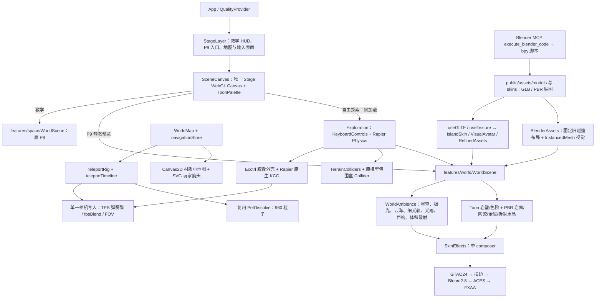

# Codex 交接提示词 15.0 · SparkMate P9 阶段性封板

你负责接续 SparkMate。P9 的物理漫游、地图传送、Blender 资产、混合渲染、生态与轻盈光轨均已获主策划最终视觉验收。本阶段已封板，暂缓 ESP32 真机联调。不要把本交接当作立即启动 P10 的指令，先等待主策划战略决策。

## 1. 基线与唯一仓库

- 版本：v0.9.7-beta。
- 基线引用：refs/tags/v0.9.7-beta（注解标签的 peeled commit 是代码基线）。
- 完整基线 hash：在新窗口执行 `git rev-parse 'v0.9.7-beta^{commit}'`；发布后的交接副本会记录实际 40 位 hash。
- 唯一工作仓库：D:\deepseek_file\ai_deskpet；分支 main；origin=https://github.com/Seange520/ai_deskpet.git。
- 不要在环境默认的 C:\Users\Senage\Documents\ChatGPT\ai硬件桌宠制作及教学软件项目 创建另一个项目副本。所有命令显式指定真实 workdir。
- 上一阶段 M2 提交：e507effc08cb153392c7a1429e7b8eb19756a3cd；P8 基线：b942a1f8da48a9e214bb0da25f16d7489ee99e67。
- 执行前读 AGENTS.md、git status、git log -1、标签与远端状态。当前授权为本次封板提交/标签/推送；后续不要自行发布新版本或修改封板标签。
- README、package.json、package-lock.json 根版本统一。历史审核记录中的“待审核/未提交”描述属于当时状态，以本封板交接为准。

## 2. 当前产品边界

这是 React/Vite 的教学网站与虚拟桌宠体验，尚未实现真实 AI 对话、编译烧录闭环。教学积分、路线、接线、代码运行器、存档语义保持原有规则，禁止为视觉或探索逻辑改写业务 Store。

P9 入口：`http://127.0.0.1:15262/?quality=3&world=p9`，点击“开始自由探索”。WASD/方向键移动、Shift 跑、空格跳、鼠标拖动视角、V 平滑 TPS/FPS、M 大地图、Esc 先关地图再退回教学。移动端有 EcctrlJoystick 与右侧拖动视角。默认教学与旧 P8 世界仍独立运行。

## 3. P9 开放世界架构图



挂载点必须区分：src/features/space/WorldScene.jsx 是旧世界；src/features/world/WorldScene.jsx 是 P9。StageLayer 与 SceneCanvas 决定启用路径。

### 物理与相机不可随意改动

- 依赖固定：React18.3.1、Fiber8.18.0、Three0.170.0、drei9.122、Rapier React1.5.0、ecctrl1.0.90、postprocessing6.39.6。
- 使用 Rapier 原生 KCC 适配，而非依赖 Ecctrl 默认动力学移动。Ecctrl 自带控制和跟随相机关闭。
- 固定步长 1/60s，重力 -9.81；胶囊 halfHeight .35、radius .3；移动2.5、跑4.2、跳跃初速5。
- KCC offset .015；最大爬坡 pi/4+.002；autostep(.51,.2,false)；snapToGround .25。已实测45°斜坡与0.5m台阶。
- TerrainColliders、原 ASSET_LAYOUT 和原 GLB 包围盒仍是碰撞真源；高精模型、密集生态、光束均为视觉层。不要自动用高模生成 trimesh 替换现有碰撞。
- Ecctrl userData 必须保持稳定的 useMemo 对象；否则渲染重建可能重置 Rapier 位姿。
- Exploration 的相机回调独占相机：4.2m 弹簧臂、fpsBlend 连续插值，FOV65→72；禁止叠加第二个 useFrame 相机控制器。
- M3 传送1.15秒：蓄力.28、冲刺.55、落位.32；复用 buildTravelCurve、相机插值和960粒子。打开地图冻结角色，Esc 顺序恢复、键盘焦点与存档隔离已验证。
- 模态、失焦和返回教学清理输入。Tier0 零 Canvas；Tier1/2 用原教学导航，不加载探索物理/GLB；减少动态效果支持直接落位。

### Blender 与渲染资产

- Blender4.5.10 LTS；本机 MCP socket localhost:9876。可通过 stdio MCP 客户端调用 execute_blender_code；不要把原始 socket 脚本冒称 MCP。
- scripts/blender-skin.py、blender-refine.py、blender-steps.py 是原创 bpy 生成源；run-blender-refine.py / run-blender-steps.py 是本机 MCP 调用示例，含本机 uv 缓存路径，换机须核实。
- 资产与纹理原创程序生成，未下载第三方模型；不是照片扫描。public/assets/models 保留原石碑/水晶/岩石；skins 包含断裂岛体、23部件机器人、73部件神殿、六棱晶簇、破损石阶与2048²沙砾法线。
- 陶瓷 clearcoat、屏幕脸/橙色天线、PBR 岩石与金属、transmission=.72/IOR1.46 水晶已验收。不要恢复白模、木板符号建筑或高亮尖钉。
- IslandSkin / RockFinish / RefinedAssets 是材质与模型挂载点；VisualAvatar 位于 KCC 的纯视觉子树。PlayerContactShadow 用地形射线与法线贴地，跳跃淡出、FPS/传送隐藏。
- FluidEnergyRail 取代 P9 的旧 EnergyRail：.012m 细弧核心、420个流动 Points、96个稀疏光雨采样点、半透明加法混合。旧 rail-tube / rail-beads 不得重新挂回 P9。
- CelestialSkyline：84座复合剪影、7800窗格；ScatteringShafts：4个局部16步体积散射代理。不是全屏后处理 Godray。
- SkinEffects 使用一个 composer；GTAO24最长边2048，Bloom2.8，Toon描边/ACES/FXAA；SkinEnvironment 配套 PMREM、软阴影与冷暖补光。不要同时挂旧 StageEffects 造成双 composer。
- 当前为最高画质视觉封板；真实低端/移动实体机性能尚未完成压测，不得把浏览器触屏模拟结果写成真机认证。

## 4. 运行与验证

使用本机 Chrome 的 Playwright；不用盲目下载新浏览器。先查端口占用，确认进程属于唯一仓库。

```powershell
npm run dev -- --port 15262 --strictPort
npm run build:local
$env:SPARKMATE_TEST_PORT='15261'
npm run test:e2e
node --test --test-isolation=none tests/m2-quality.unit.mjs tests/quality-tier.unit.mjs tests/travel-timeline.unit.mjs tests/teleport-timeline.unit.mjs
node scripts/check-world-rail.mjs
```

最新封板验证：原 E2E67/67、质量/传送单测8/8、最终视觉专项3/3（零页面/着色器错误）、生产构建2871模块通过。此前物理专项M1 8/8、地图传送M3 6/6、资产M2 5/5通过；本轮物理源码审计保持一致。

Windows 系统 TEMP 的 esbuild 清理曾报拒绝访问；使用既有 build:local 将临时目录定向到项目缓存。不要误当成业务构建错误。测试时冻结源码，避免 Vite 热更新导致 Playwright Canvas句柄上下文失效；失败须查原因再复测，不改断言掩盖问题。

最新审核文档 docs/P9_LIGHT_RAIL_REVIEW.md；历史还有 P9_FINAL_ART_REVIEW、P9_SKIN_REVIEW、P9_M3_MAP_TELEPORT_REVIEW。截图/日志在本机：
C:\Users\Senage\.codex\visualizations\2026\11\07\01a1b693-ded6-7e71-9e57-3be30f4fe3f6\sparkmate-light-rail
主审核图 rail-tps-panorama.png，旁有 rail-checks.json、blender-result.json、physics-audit.json、e2e-last-run.json。Playwright会清理test-results，长期证据应保存到独立目录。

GitHub 直连在本机不可用，系统已有代理127.0.0.1:7897，可对单次 Git 命令使用 -c http.proxy=http://127.0.0.1:7897；不要改全局代理，不输出凭据，不 force push。推送 main 可能触发仓库既有部署自动化，本次未额外创建 GitHub Release 或手动部署任务。

## 5. 【P10 待办池（挂起）】

**真机 ESP32 硬件联调暂缓，等待主策划进一步战略决策。**

下阶段候选重点，均未获开工指令：
1. 移动端实体机性能压测：真实 iOS/Android 的帧时间、温升、显存、长时稳定性、触控和各 Tier 回退。
2. Tauri 桌面端封装评估：WebView/WebGL/WASM 支持、打包大小、权限与升级；目前没有 Tauri 工程，不要假定已接入。
3. 更多大世界探索玩法：先提出具体体验与边界，再按批准范围实现，守住教学业务隔离。

不要自动启动固件烧录、串口真机探测、Tauri脚手架或新玩法开发。用户当前要求本次封板后结束任务并休眠；新窗口读取本交接、确认基线后等待下一条指令。
