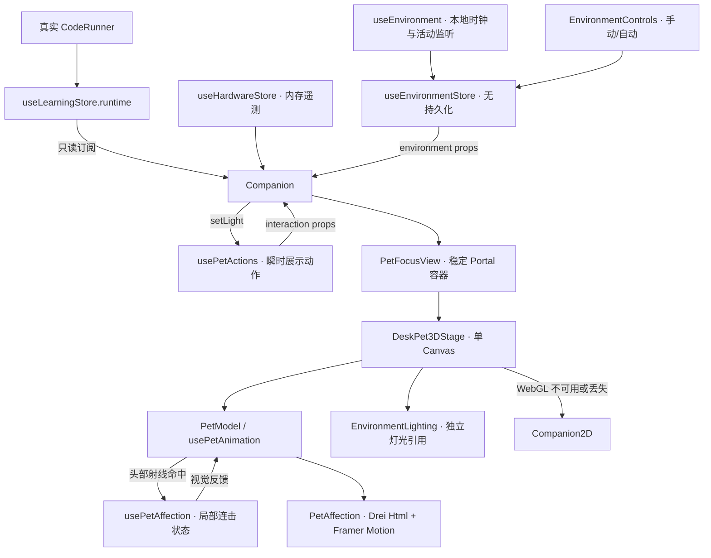
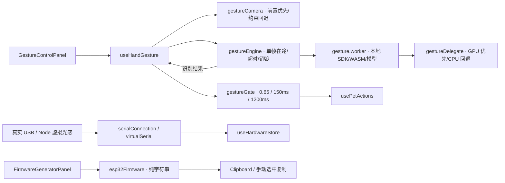

# SparkMate 开发日志与架构规范 4.0

本文档记录了我在 2026-11-04 完成的四轮迭代：全屏聚焦与摸头互动、ESP32 固件代码面板、手势双引擎与移动端适配，以及昼夜和情绪系统。它整理了当前模块边界、验证结果和后续维护规范，方便继续迭代时查清数据从哪里来、哪些行为不能被改坏。

## 1. 封版记录与工作区

- 唯一主场：`D:\deepseek_file\ai_deskpet`。禁止在 C 盘旧副本或其他副本实施改动；命令显式指定工作目录。
- 分支：`main`；远端：`https://github.com/Seange520/ai_deskpet.git`。
- 当前业务代码封版基线：`f1c6d1219fbfceee51d11360028507eddb1d3199`，已推送到 origin/main。
- 本次收尾仅新增本开发日志，不新增业务功能、不改已有验证断言，不创建发布 tag。日志提交后，仓库最新提交以 `git rev-parse HEAD` 为准，业务基线仍为上面的功能提交。
- V3 是上一阶段的历史记录；当前参数、架构与维护规范以本文及相关模块文档为准。

| 模块             | 已提交的业务基线                           | 本轮结果                                          |
| ---------------- | ------------------------------------------ | ------------------------------------------------- |
| 全屏聚焦与摸头   | `ac78958f07f55b3059b22e4bac550615ede8bc76` | 同一个 Canvas 放大展示，射线摸头、爱心与音效      |
| 固件生成器       | `eac48d52ecedadfe4746e3eff09c46c6dd5ec948` | 前端 Arduino 字符串模板、新手指引、复制与手动兜底 |
| 双引擎与全端适配 | `49a9822cc45a42e8b52965546a52b7cdac859ce3` | GPU/CPU 初始化回退、手势限速、小屏布局与 DPR 策略 |
| 昼夜与情绪       | `f1c6d1219fbfceee51d11360028507eddb1d3199` | 本地时间氛围、闲置休眠、连击晕圈与独立环境状态    |

### 技术栈

本轮没有安装或升级依赖，package.json 与 package-lock.json 保持不变。以下版本已从安装目录核对：

| 层级                                         | 版本                       |
| -------------------------------------------- | -------------------------- |
| React / React DOM                            | 18.3.1 / 18.3.1            |
| Vite / React 插件                            | 6.4.5 / 4.7.0              |
| Zustand                                      | 5.0.16                     |
| Tailwind CSS / Framer Motion / Lucide React  | 3.4.19 / 11.18.2 / 0.468.0 |
| React Three Fiber / Drei / Three.js          | 8.18.0 / 9.122.0 / 0.170.0 |
| MediaPipe tasks-vision（直接依赖，精确锁定） | 1.2.2                      |
| Playwright / Prettier                        | 1.64.1 / 3.9.10            |

沿用 npm 与现有锁文件；Drei 的 tasks-vision 0.10.17 嵌套传递依赖保留。不要为去重而强行升级 React/Fiber/Drei，也不用 --force 或 --legacy-peer-deps 掩盖依赖冲突。

## 2. 当前架构与数据边界

学习业务仍由原 CodeRunner 和 useLearningStore 负责。新能力分成硬件遥测、展示动作、环境氛围和局部互动四层，只把展示需要的数据传入场景。





固件代码面板、硬件面板和手势面板由 `src/components/CodeLab.jsx` 组装。固件面板没有后端和串口发送链路。主 3D 场景不导入学习 Store、demo 运行器或硬件连接器；音效由 Companion 传入回调，只读原静音设置。

## 3. 四个模块的实现记录

### 全屏聚焦与摸头

聚焦模式移动稳定 Portal 容器，在常驻槽位和 body 下的模态框之间复用同一个 Canvas，不创建第二个 renderer。关闭后恢复原视角和收起状态；支持 Esc、Tab 焦点约束、背景 inert、滚动锁定及焦点恢复。

OrbitControls 支持鼠标旋转/缩放和触摸单指旋转/双指缩放。画布局部 touch-action:none 是为了把手势交给控制器，画布外仍能滚动。短屏视图可滚动，并用 minmax(0, 1fr) 与 min-width:0 防止横竖屏切换后被旧 Canvas 宽度撑开。

PetModel 在头部 group 绑定 onClick，R3F 对子 mesh 做射线命中；只接受主键，过滤移动超过 5px 的拖拽。普通开心反馈保持 700ms 节流；键盘「摸摸头」复用同一入口。Drei Html 锚点在头部局部坐标 `[0, 1.95, 0]`，通过相机投影跟随头部、视角和视口变化，再由 Framer Motion 执行 DOM 上浮淡出。特效不接收指针事件，关闭/暂停/休眠时清理。

### ESP32 固件生成器

硬件连接面板下方默认折叠，展开后显示新手指引和 Arduino 代码。模板每秒以 115200 波特率输出一行模拟数据 `{"light":300,"temp":25.0}`，无需外接传感器；light 可改为 50 体验暗光休眠。数据与原遥测解码器兼容，不把模拟值称为真实测量。

Clipboard 成功后提示可粘贴；权限拒绝或 API 缺失时选中代码并提示手动复制。用户在 Arduino IDE 中自行选择开发板、端口和烧录，网页不执行烧录、连接或控制命令。连接网页前关闭 IDE 串口监视器；原生 USB 板型按自身说明配置 USB CDC。

### 双引擎手势与移动端适配

Worker 检测 navigator.gpu：存在时优先创建 MediaPipe GPU delegate；初始化异常后尝试 CPU；不存在时直接 CPU。两者失败则沿用原错误关闭与禁用提示。GPU/CPU 仅在初始化成功后上报，界面另行展示 WebGPU API 能力和当前英文手势名；关闭/失败清空状态。GPU delegate 不等于全流程 WebGPU，当前 SDK 使用 WebGL 上下文，部分算子仍由 CPU 执行。

- Open_Palm → jump；Closed_Fist → sleep。
- Worker 分类阈值和门控阈值均为 0.65，稳定窗口 150ms，冷却 1200ms；持续持有同一手势不重复触发。
- 推理开始时间间隔至少 100ms，最高 10 FPS，最多一帧在途；按已耗时调度下一帧，而不是推理完再额外固定等 100ms。
- 摄像头优先前置、320×240、10 FPS，audio:false。仅对约束不兼容且会话仍有效的情况回退通用视频请求，不二次请求已拒绝的权限。
- 初始化超时 25s、单帧超时 5s；关闭、离页、后台和异常均释放 tracks、Worker、计时器与 ImageBitmap，清空 video.srcObject。模型/WASM 同源按需加载，视频不录制、不上传。
- USB 按安全上下文和 navigator.serial.requestPort 能力判断，不按手机 UA 判断。缺失时按钮置灰并提示电脑端体验；摄像头与 USB 能力独立。
- 小屏（<=700px）或已报告 CPU 核数 <=4 / 内存 <=4GB 的设备 DPR 固定为 1；其他聚焦设备上限 1.5，常驻仍为 1。保留低功耗偏好、按需渲染和原 2D 回退；小屏减轻背景模糊。
- 控制区使用响应式布局，主要触摸入口至少 44px。媒体查询监听兼容旧 addListener，并在卸载时移除。

### 昼夜与情绪

默认跟随浏览器 `new Date().getHours()`，19:00 起至次日 06:00 前为夜间；每 30 秒复核，恢复页面可见时立即同步。聚焦模式可强制白天/黑夜或恢复跟随时间，会话内保留选择，刷新恢复自动。

EnvironmentLighting 单独阻尼三个灯光强度，不重置 runtime、动作事件、Canvas 或模型；夜间只半闭眼和轻微低头，不阻断真实沙盒、jump/spin，也不改清醒状态下的 LED 指令亮度。睡眠由 `interaction.dark || interaction.sleeping || environment.idleSleeping` 决定，任一原因成立就保持休眠。

一分钟无 pointermove/pointerdown/touchstart/keydown/wheel 时设置闲置休眠。用户活动只清除闲置标志，不解除硬件暗光或手动休眠；使用一个延迟检查器，避免每次鼠标移动都重建定时器。隐藏时清理计时器，卸载时移除监听。

1.8 秒内三次有效摸头触发约 1.8 秒的头部 Y 轴摇晃与星星，80ms 内重复事件过滤，晕圈 2.2 秒内不重复触发。爱心与晕圈使用独立动画 key，避免沿用上一段淡出进度。减少动画时不摇头、不上浮，仅静态淡出。昼夜/晕圈音效峰值增益 0.012，遵守静音与无音频 API 降级；自动时钟切换只复用已运行的 AudioContext，首次加载不发声、不主动创建或恢复音频上下文。

## 4. 模块路径导航

以下路径相对唯一主场。核心文件接近 300 行时按职责拆分，不靠压缩代码降低行数。

| 文件                                                | 职责                                      |
| --------------------------------------------------- | ----------------------------------------- |
| `src/components/Companion.jsx`                      | 只读 runtime/静音，组装独立动作与环境展示 |
| `src/components/CodeLab.jsx`                        | 原工坊业务及三个独立面板入口              |
| `src/components/Dashboard.jsx`                      | 仪表盘响应式间距与最小宽度                |
| `src/features/deskpet3d/DeskPet3DStage.jsx`         | 单 Canvas、相机、暂停与 WebGL 错误边界    |
| `src/features/deskpet3d/PetFocusView.jsx`           | 稳定 Portal、模态焦点、inert 与滚动恢复   |
| `src/features/deskpet3d/PetModel.jsx`               | 几何体、材质、头部射线事件和特效锚点      |
| `src/features/deskpet3d/usePetAnimation.js`         | 原动作阻尼、困倦表情和局部晕圈叠加        |
| `src/features/deskpet3d/usePetAffection.js`         | 摸头节流、连击、晕圈和清理                |
| `src/features/deskpet3d/PetAffection.jsx`           | Html 坐标投影与爱心/星星 DOM 动效         |
| `src/features/deskpet3d/EnvironmentLighting.jsx`    | 独立灯光引用与昼夜过渡                    |
| `src/features/deskpet3d/useSceneQuality.js`         | 小屏/低性能检测、媒体查询生命周期         |
| `src/features/deskpet3d/focus.css`                  | 聚焦布局、安全区、短屏与触摸样式          |
| `src/features/hardware/FirmwareGeneratorPanel.jsx`  | 折叠固件展示、复制与失败兜底              |
| `src/features/hardware/esp32Firmware.js`            | 纯前端 Arduino 模拟遥测模板               |
| `src/features/hardware/firmware.css`                | 深色代码块与窄屏布局                      |
| `src/features/hardware/HardwareConnectionPanel.jsx` | USB 能力提示、虚拟入口与只读遥测          |
| `src/features/hardware/serialConnection.js`         | 原串口 provider、分行解码与释放           |
| `src/features/hardware/useHardwareStore.js`         | 真实/虚拟连接互斥、内存遥测               |
| `src/features/interaction/useHandGesture.js`        | 授权、单帧调度、状态反馈与资源清理        |
| `src/features/interaction/gestureCamera.js`         | 前置摄像头偏好与约束回退                  |
| `src/features/interaction/gestureEngine.js`         | Worker 通信、初始化与推理超时             |
| `src/features/interaction/gesture.worker.js`        | SDK/WASM/模型推理与引擎元数据             |
| `src/features/interaction/gestureDelegate.js`       | 可独立验证的 GPU/CPU 初始化回退           |
| `src/features/interaction/gestureGate.js`           | 阈值、稳定窗口、冷却和去重                |
| `src/features/interaction/usePetActions.js`         | 原隔离展示动作与光照优先级                |
| `src/features/interaction/GestureControlPanel.jsx`  | 手动动作、摄像头和实际引擎/手势提示       |
| `src/features/environment/useEnvironmentStore.js`   | auto/day/night、hour、night、idleSleeping |
| `src/features/environment/useEnvironment.js`        | 时钟、活动监听、背景标记与生命周期        |
| `src/features/environment/EnvironmentControls.jsx`  | 昼夜手动切换与恢复自动                    |
| `src/features/environment/environment.css`          | 夜间背景与环境状态样式                    |
| `src/lib/sounds.js`                                 | 共享音频上下文、轻提示音与静音边界        |
| `playwright.config.js`                              | 独立端口、无头执行与展示环境固定参数      |

## 5. 必须保持的红线

1. 不改主学习 Store 的结构、XP、通关、Debug、四路线数据、原沙盒解析和 v1 迁移规则；存档键仍为 sparkmate.routes.v2。新交互、硬件、环境状态不触发学习完成/保存，不写学习进度或 localStorage。真实主线不能换成 DemoCodeRunner，独立 demo 不得意外解锁路线。
2. 主备分离：保留 Companion2D、原 2D 资源及 WebGL 缺失/丢失回退；四路线教学爆炸图保持现有 2D。只使用单 SPA 生产入口，不恢复部署易 404 的 demo 多入口。
3. 原 65 项 E2E 不删、不跳过、不弱化断言。新增功能使用独立补验或新增单测。服务使用空闲独立端口与 strictPort，不复用未知服务、不终止用户已有服务；冻结源码后再跑完整回归，避免热更新打断导航。
4. 移动端按能力检测降级，不用 UA 一刀切；无 USB 能力禁用对应入口，无摄像头能力禁用手势。WebGPU 缺失不影响 WebGL 3D；GPU 初始化失败尝试 CPU，全部失败关闭资源并提示，不能白屏。
5. 保留 DPR 策略、单 Canvas、按需渲染、后台/业务模态暂停、reduced-motion、焦点、inert 和原音效边界；不在页面全局拦截触摸滚动，不以无头采样宣称全部手机性能或长期无泄漏。
6. 自动环境时钟不创建或恢复音频上下文；新增轻音效必须遵守原静音。活动唤醒只能清除闲置原因；夜间困倦不能冒充硬件暗光，也不能覆盖真实 runtime 或解除手动休眠。
7. VITE_SPARKMATE_ENVIRONMENT=regression 仅用于展示层回归环境：固定 12 点并停用新增闲置计时。禁止写入生产环境文件或用于跳过业务校验；正常功能必须另在不设置该参数的服务中验证。不得以 headless/navigator.webdriver 为条件暗中禁用功能。
8. 固件面板仅生成/复制文本，不自动烧录、连接串口或发送硬件控制命令。默认不申请摄像头/串口权限；真实/虚拟连接互斥，视频不录制、不上传。
9. 提交/推送按用户当次授权执行；旧 AGENTS.md 的自动提交约定不替代当前授权。禁止擅自发布、打 tag、强推、重置用户改动或改全局 Git 身份；未经任务授权不更改 Vercel 配置、实体固件或部署。
10. 重大依赖/构建问题停止并报告，不强制升级绕过。联网前提醒并确认代理可用；需要代理时仅给命令进程使用 127.0.0.1:7897，不关闭 TLS、不保存凭据。

## 6. 验证记录与复验方式

最近一轮业务封版验证（此前完成，本次仅更新日志）：

- npm run build:local：成功；仍有既有 3D 大 chunk 提示，未宣称首屏体积问题已解决。
- npx playwright test：65 通过 / 0 失败 / 0 跳过，约 5.5 分钟。仅配置测试服务器的环境固定参数，原用例与断言不变；当前 .last-run.json 为 passed、failedTests 为空。
- 七组 Node 单元测试：28/28 通过，包含新环境边界与原学习、串口、手势用例。
- 聚焦、固件复制、双引擎/移动端、昼夜/情绪独立补验均已通过；主线单 Canvas、真实 runtime、模态/后台暂停和 2D 回退已有补验通过记录。
- 真正的本地 SDK/WASM/官方模型已用合成视频完成 GPU 路径推理；GPU 初始化失败等确定性分支由工厂单测/测试 Worker 验证，不等同于每种实体 GPU 上均已实测。
- 固件示例做过本机 C++ 编译器加 Arduino API 桩的语法和 JSON 输出检查，不等同于 ESP32 工具链编译、真实 USB 或实体烧录验收。
- 未实测真实手机摄像头准确率、长时间发热与真实 ESP32；未验证所有 Linux/Vercel 构建、所有 QA 或长期资源无泄漏。

基本复验（端口仅为示例，先确认空闲）：

```powershell
Set-Location 'D:\deepseek_file\ai_deskpet'
git status --short
git rev-parse HEAD
npm run build:local
$env:SPARKMATE_TEST_PORT='5261'
npx playwright test
node --test tests/environment.unit.mjs tests/gesture-adaptive.unit.mjs tests/interaction.unit.mjs tests/serial.unit.mjs tests/code-runner.unit.mjs tests/levels.unit.mjs tests/debug.unit.mjs
```

Playwright 配置只给其 webServer 子进程设置回归参数，不会把正常开发或生产构建自动改成白天。仅锁文件变化或确实缺少依赖时才 npm ci；沿用现有 node_modules 无需重装。

旧聚焦/动作几何补验需要白天基准时，在专用终端临时设置参数后启动独立服务：

```powershell
$env:VITE_SPARKMATE_ENVIRONMENT='regression'
npm run dev -- --port 5232 --strictPort
# 对应补验终端填写该服务地址
$env:SPARKMATE_FOCUS_URL='http://127.0.0.1:5232'
node scripts/check-pet-focus.mjs
$env:SPARKMATE_MAIN_URL='http://127.0.0.1:5232'
node scripts/check-main-deskpet3d.mjs
$env:SPARKMATE_INTERACTION_URL='http://127.0.0.1:5232'
node scripts/check-phase4-interaction.mjs
```

真实环境功能另起正常服务，启动前从该终端环境移除参数，不把参数写进 .env 或生产设置：

```powershell
$env:VITE_SPARKMATE_ENVIRONMENT=$null
npm run dev -- --port 5233 --strictPort
# 以下命令在另一个终端运行，按实际服务地址填写
$env:SPARKMATE_FIRMWARE_URL='http://127.0.0.1:5233'
node scripts/check-firmware-generator.mjs
$env:SPARKMATE_ADAPTIVE_URL='http://127.0.0.1:5233'
node scripts/check-adaptive-mobile.mjs
$env:SPARKMATE_ENVIRONMENT_URL='http://127.0.0.1:5233'
node scripts/check-environment.mjs
```

较重的真实模型补验建议串行运行，保留原 25s/5s 保护，不因本机并发软件渲染慢而放宽保护。昼夜补验用 Playwright Clock 验证分钟级计时，原生 Framer/Web Animations 可见度另用真实帧时间验证，避免假 performance 时钟与浏览器原生动画时间线不一致。报告、截图与本地临时检查产物位于忽略提交的 test-results，不纳入源代码。

## 7. Backlog

以下是后续规划，不构成本轮实现或自动授权；本轮四个模块已完成，不再把它们整体列为未实现。

- 真机验收：在不同手机、桌面摄像头、光照、距离与浏览器上记录识别延迟、误触、热量和长时资源；补足 GPU 不可用/驱动异常与移动端权限恢复记录。
- ESP32 联调：用明确板型确认 Arduino 工具链、USB CDC、真实 JSON 输出、串口断连及光感阈值。真实传感器接线、采样标定、设备身份/协议版本、固件烧录与执行器控制另行约定授权和验收。
- 加载与性能：优化模型/WASM 加载进度、缓存与失败重试，评估首屏 3D 分包体积与低端设备预算；继续保留用户开启后的按需加载、单帧在途与单 Canvas。
- 环境体验：实测跨时区、系统时间修改、长时间后台恢复与多种输入活动；讨论是否需要可调闲置时长、夜间强度和配置存储，避免污染学习存档。
- 交互边界：长时验证晕圈/摸头、休眠原因、静音与减少动画的组合；补充 WebGL 恢复、反复横竖屏和极短屏的持续回归。
- 个性化：研究自定义颜色、外观与独立配置存储，不扩展主学习数据结构。
- 教学扩展：四路线 3D 爆炸图独立立项，先验证教学收益与性能，保留现有 2D；不要顺手扩大当前范围。
- 工程验证：在另行安排的 Linux/生产预览环境补齐构建与部署兼容验证；发布和部署需按当次授权执行。

细节参考：[V3 历史开发日志](DEVLOG_V3.md)、[3D 伙伴](deskpet3d.md)、[动作与手势](phase4-interaction.md)、[Web Serial 与固件面板](web-serial.md)、[昼夜与情绪](environment.md)、[原业务架构](architecture.md)。
