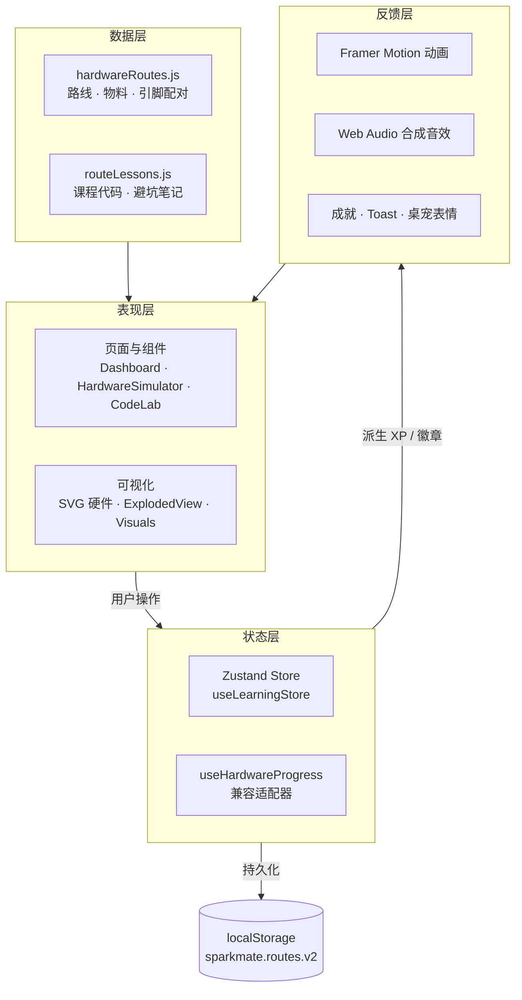

# SparkMate 技术架构与难点说明

> 本文档用于大创评审与开源协作，说明「为什么这样设计」以及关键难点的解决方式。
> 配套阅读：[README](../README.md) · [功能矩阵](feature-list.md) · [竞赛摘要](competition-summary.md)

## 1. 架构总览

SparkMate 是纯前端 SPA：Vite 构建、React 渲染、Zustand 持有全局学习状态，无后端与账号体系，学习进度保存在浏览器本地。



**设计原则**

- **数据与视图分离**：路线差异全部由数据描述，组件只负责渲染与交互。
- **单一状态源**：任何「进度、XP、成就、静音」只存在 Store 中，组件不持有副本。
- **派生优先**：XP、等级、徽章由完成态计算，不额外存储可漂移的余额。
- **渐进增强**：无存储、无音频、无动画偏好时均优雅降级，不阻断学习流程。

## 2. 数据驱动设计

| 数据文件                     | 职责                                                                          | 扩展方式                     |
| ---------------------------- | ----------------------------------------------------------------------------- | ---------------------------- |
| `src/data/hardwareRoutes.js` | 四条路线的 ID、名称、难度、物料清单与价格、内联 SVG、爆炸图零件坐标、引脚配对 | 新增路线只需追加一个配置对象 |
| `src/data/routeLessons.js`   | 每条路线的示例代码、参数范围与教学提示                                        | 按 `routeId` 增加课程条目    |

- `ExplodedView.jsx` 依据配置中的零件坐标与层级渲染 2.5D 拆解，**不为每条路线手写布局**。
- 物料清单、连线校验、实验预览均读取同一份配置，保证「物料 ↔ 接线 ↔ 代码」三处一致。
- 配置为纯数据模块，可被 Node 脚本静态校验（`npm run qa` 会动态 import 校验四路线完整性）。

## 3. 状态管理设计

### 3.1 Store 结构

```js
useLearningStore = create((set, get) => ({
  ...load(), // 从 localStorage 恢复
  storageError, // 存储不可用标记
  feedback, // 一次性反馈事件（不持久化）
  selectRoute,
  complete,
  fail,
  recover,
  toggleMuted,
  reset,
}));
```

### 3.2 关键决策

| 决策                                 | 原因                                                        |
| ------------------------------------ | ----------------------------------------------------------- |
| XP / 徽章派生而非存储                | 避免「完成态与积分不一致」的经典漂移问题，重置/迁移天然一致 |
| 反馈事件不持久化                     | 刷新后不重播 Toast / 音效，符合用户预期                     |
| `subscribe` 统一持久化               | 避免每个 action 手动写存储、遗漏字段                        |
| 显式迁移旧键 `sparkmate.progress.v1` | 老用户进度不丢失；迁移成功后删除旧键，防止重置后旧数据复活  |
| 存储异常降级为内存态                 | 隐私模式/禁用存储时仍可学习，仅提示不持久                   |

### 3.3 状态流转

`用户操作 → action → set(新状态) → subscribe 持久化 → React 重渲染 → 反馈层（动画/音效/成就）`

## 4. 关键交互难点与解法

### 4.1 2.5D 爆炸图

- **难点**：需在无 3D 引擎的前提下表现「主板—屏幕—麦克风/舵机」的空间层次，且要能被测试稳定断言。
- **解法**：透视容器 + `transform: translateZ()` 分层，展开/合拢由父容器 class 驱动；减少动画偏好下关闭过渡。
- **可测性**：E2E 不依赖 class 名，而是采集元素及其祖先的计算样式指纹，按钮文案与样式任一失效都会失败。

### 4.2 拖拽接线校验

- **难点**：接线规则因路线而异（电源、共地、PWM、I²C 等），错误类型需区分「烧板级」与「普通接错」。
- **解法**：配对规则写在路线配置中；`fail` 区分严重等级，VCC→GND 触发全屏烧板遮罩并锁定焦点，普通错线仅红线反馈。
- **无障碍**：拖拽之外提供键盘选择与确认路径，焦点可见、Esc 可退出。

### 4.3 全局状态与音效/成就联动

- **难点**：奖励只发一次、跨路线共享、刷新不重播、重置后行为一致。
- **解法**：完成态幂等写入；奖励与徽章从完成态派生；音效统一走 `playSound(kind, muted)`，AudioContext 仅在用户交互后创建，失败静默降级。

### 4.4 视觉与性能

- 纯 CSS/SVG 绘制硬件，无图片请求；大量装饰动画使用 CSS 合成属性，避免逐帧 React 渲染。
- 玻璃折射、磁吸倾斜等在触屏与 `prefers-reduced-motion` 下自动关闭，保证低端设备可用。

## 5. 测试与质量保障

| 层次       | 手段                                                                                        |
| ---------- | ------------------------------------------------------------------------------------------- |
| 端到端     | Playwright 覆盖四路线入口、拆解、接线、烧板恢复、键盘/触屏、移动布局                        |
| 双向验证   | 注入「音效报错 / 拆解无效 / 导航失效」等缺陷，确认测试能失败                                |
| 上线前质检 | `scripts/qa-check.mjs`：路线完整性、Store 规范、成就/音效接线、敏感信息、仓库卫生、构建预检 |
| 可访问性   | 语义化定位器、焦点管理、减少动画、存储降级提示                                              |

## 6. 风险与演进方向

- **教学准确性**：引脚分配为示例，需在真实硬件阶段核对数据手册并补充 BOM。
- **范围控制**：当前不执行电路仿真与固件编译，避免给用户「已可制造」的错误预期。
- **下一步**：真实语音链路、可编译固件、桌面端打包（Electron / Tauri）与教师端课程编排。

> 📝 待补充：性能基准数据（首屏、动画帧率）、真实设备联调记录、课程知识点映射表。
